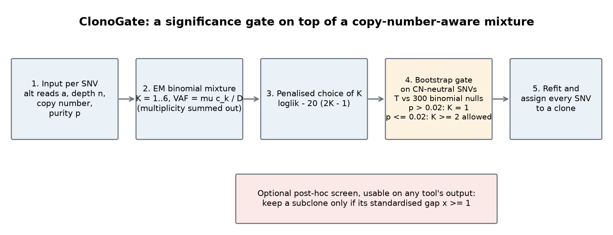
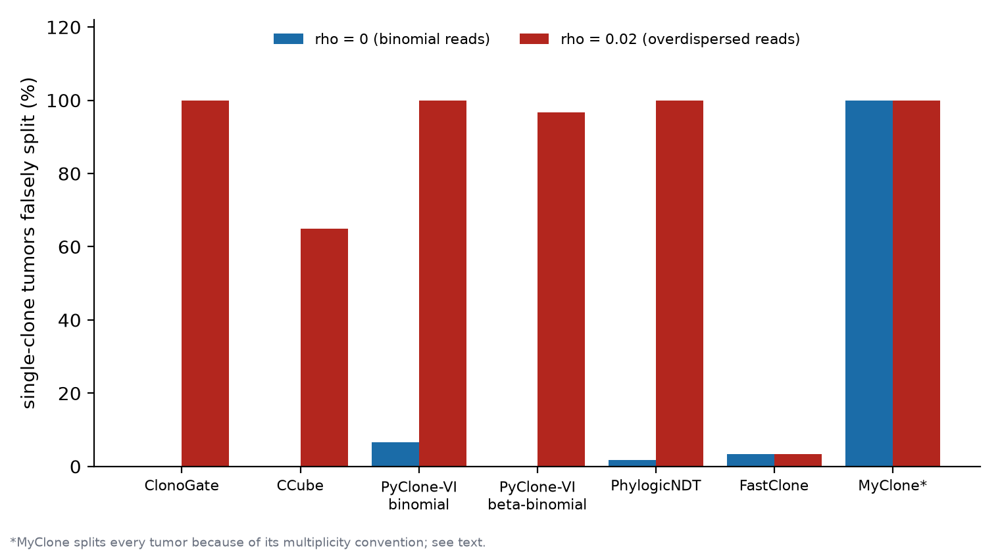
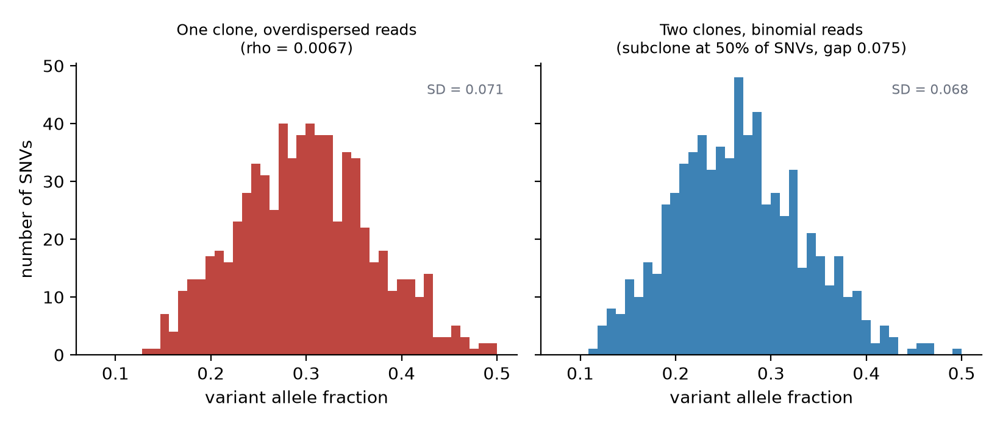
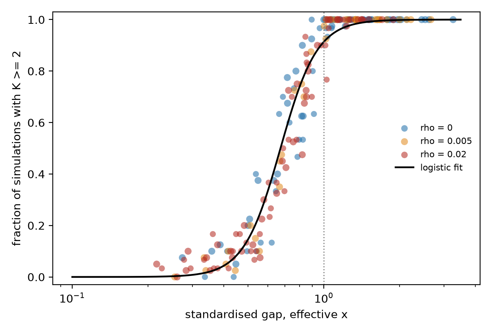
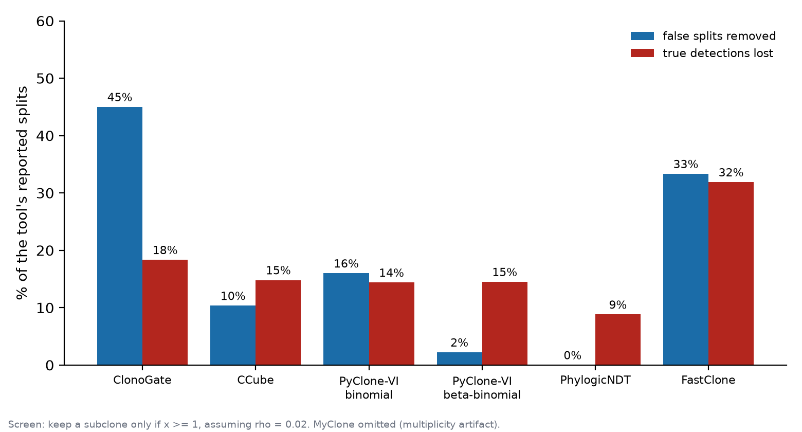
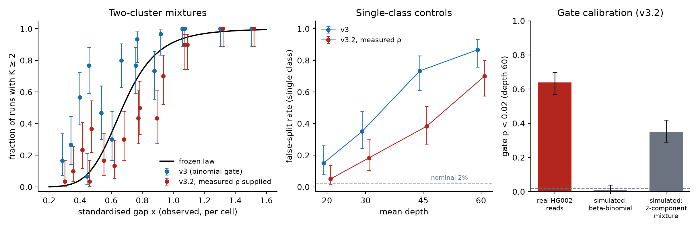

# When Is a Subclone Real? Read Overdispersion Creates False Subclones in Single-Sample Tumor Reconstruction

*Regeneron STS research report draft (v9). Every number below comes from our simulation and analysis result files. The SMC-Het challenge data are simulated, and so are almost all of our stress tests. Real sequencing reads enter in three places: a measurement of read noise (Section 8), a test on a physical cell-line mixture that failed for lack of usable data (Section 8.1), and a test on computational mixtures of real reads from two cell lines (Section 8.2). None of these is a real tumor with known subclones, so this report makes no real-tumor validation claim.*

---

## Abstract

Reconstructing a tumor's subclones from one bulk sample means deciding when differences between mutations' variant allele fractions (VAFs) reflect different clones and when they reflect noise. We found that when read counts vary more than ordinary sampling predicts (overdispersion), reconstruction methods report subclones that are not there. At an overdispersion of ρ = 0.02 (about seven times our real-data estimate, although six benchmark designs fit above it), our own model and two widely used published tools split 60 of 60 single-clone simulated tumors, and every published tool we ran failed in at least one way. We traced the failures to three mechanisms (overdispersion, ambiguous mutation multiplicity, subclonal copy number reported as a single state) and argued that the first is hard to repair from one sample: a beta-binomial's excess variance ρq(1 − q) does not depend on depth, and a real subclone adds the same kind of excess, so stratifying by depth cannot by itself separate them. Guessing the noise level wrong costs very differently in the two directions: when our model was given half the true ρ (0.005), 23 of 60 simulated single-clone tumors were still falsely split (42 of 60 with no allowance for noise), while giving it twice the true ρ removed every false split but cut detections of a subclone with a 25% prevalence deficit from 50 to 24 of 60.

We found this while building **ClonoGate**, a copy-number-aware binomial mixture with a parametric-bootstrap gate, motivated by the SMC-Het benchmark's finding that algorithm choice matters more than tumor features and that no algorithm wins every task. On the benchmark, after we recovered the baseline runs that had first failed or timed out, ClonoGate scored higher on clustering than all four published tools we re-ran over the 51 designs; on the 26-design preregistered holdout its clustering advantage is clear over FastClone and Object Integration but not distinguishable from zero over CCube and PhylogicNDT. It is level with or slightly behind CCube and PhylogicNDT on prevalence. We claim neither a leaderboard rank nor state of the art. The SMC-Het challenge data are simulated, and nearly all of our results come from simulation. We tried a physical cell-line mixture with known variant fractions, which failed because the mixture was not publicly downloadable (Section 8.1), and we tested computational mixtures of real reads from two Genome in a Bottle cell lines (Section 8.2). There, real read noise (ρ ≈ 0.0025, in line with the germline measurement) made ClonoGate split 126 of 240 single-class samples (52%, seed-resampled interval 47–58%; 87% at depth 60), and the x ≥ 1 screen kept 1 of those 126 false splits. Giving the beta-binomial version the measured ρ, which is how the detection law was tested in simulation, lowered the false-split rate only to 33% [28%, 38%] (67–73% at depth 60, against 1 of 60 at the true ρ in simulation), and the law then over-predicted detection by 0.17–0.41 between x of about 0.6 and 0.95 (a 50% split rate was reached near x of 0.8–0.9, not 0.67; RMSE 0.18 [0.15, 0.24] against 0.07 in simulation), agreeing only from x of about 1.07. The gate is calibrated for beta-binomial data (1% false splits in 200 simulated draws) but not for these reads (64%); a mixture in which about 1% of sites have very high noise reproduces about half of that excess (35%), so heavy-tailed site-level bias is a supported but incomplete explanation. These are germline mixtures, not tumors, so whether the findings hold on real tumors remains untested.

The failure raised a sharper question: when can any method tell a subclone from noise? In simulation, the probability that ClonoGate detects a real subclone (reports two or more clusters, not necessarily the true subclone) follows one standardised gap, x = Δq / √(q(1 − q)(1/depth + ρ)): 50% at x ≈ 0.66–0.67 and roughly 90% or more from x ≥ 1, an empirical relationship that extrapolates to held-out simulation settings with half the error of its simple form. With its coefficients frozen and its predictions written to a file before any run, it then predicted detection in 48 new simulated settings, half of them from a different noise generator, with a root-mean-square error of 0.07 against a sampling-noise floor of about 0.06 (the simple form: 0.21). It suggests a screen, "keep a subclone only if x ≥ 1", that removes 45% of ClonoGate's false splits in our pooled noisy tumors (with ρ assumed to be 0.02) at an 18% cost in true detections. On a new simulation family planned before any fit (960 tumors, half from a different noise generator) the screen's operating point carried over without retuning: with ρ assumed 0.02 it removed 54% [50%, 58%] of ClonoGate's false splits and lost 17% [15%, 20%] of true splits, at a cost in accuracy (mean ARI 0.24 to 0.22). A plain gap cutoff tuned on the earlier data did not carry over (it lost 27% of true splits against its 18% target), and for ClonoGate, at matched loss, the standardised gap removed somewhat more false splits (56% against 50% at up to 18% loss), though not for PyClone-VI or CCube. The screen removes few false splits from tools whose spurious gaps are large. A germline-heterozygote control, which we derived by reasoning about which mutations have a known true VAF, measured real read noise at ρ = 0.0030 in public sequencing data.

---

## Contributions at a glance

1. **The central finding (Section 4).** Unmodelled read variation produces false subclones across reconstruction methods: five published tools and our own, in seven configurations on identical simulated data, over-split once read noise departs from binomial (ρ = 0.02 in our test), by three mechanisms. This may be one reason no benchmarked algorithm wins every task (an untested hypothesis, Section 1).
2. **Why it resists a one-sample fix (Section 5).** A second-moment derivation shows that a depth-independent variance excess is also what a real subclone adds. We worked it out after our first fix failed; the shape test and a precision sweep were then consistent with it.
3. **An empirical detection relationship, tested as a prediction, and a screen (Sections 5 and 6).** Detection of a simulated subclone by ClonoGate follows the standardised gap x. With its coefficients frozen and its predictions recorded in advance, the relationship predicted 48 new simulated settings (half from a different noise generator) to an RMSE of 0.069, close to the sampling-noise floor of about 0.06. It motivates a screen computable from any tool's output. The screen is a screen, not a fix: it removes 45% of ClonoGate's false splits in the original pool and 54% [50%, 58%] on a new 960-tumor family (losing 17% [15%, 20%] of true splits and lowering mean ARI from 0.24 to 0.22), but few of those from other tools. On the new family a plain gap cutoff tuned on the old data did not transfer (27% of true splits lost against an 18% target) while the preset x ≥ 1 did, and for ClonoGate, at matched loss, the standardised gap does somewhat better (not for PyClone-VI or CCube); everything is simulation, from our own two generators, and the law did not transfer to the real-read mixtures of Section 8.2.
4. **What a wrongly assumed noise level costs (Section 6).** Supplying the model with the true ρ repairs its false splits, but a one-sample analyst does not know ρ. Misspecifying it is asymmetric: assuming too little leaves false splits (42 of 60 at ρ assumed 0, 23 of 60 at half the truth, against 0 of 60 at the truth) and assuming too much loses real subclones (24 of 60 detections at twice the truth, 0 of 60 at four times, against 50 of 60 at the truth, for a 25% prevalence deficit). The pattern repeats at the measured ρ = 0.003 (32 of 60 false splits with no allowance, 9 of 60 at half the truth, 1 of 60 at the truth).
5. **ClonoGate and the recovered baselines (Sections 2 and 3).** Ahead on clustering against all four tools we re-ran over the 51 designs, but on the preregistered 26-design holdout the intervals against CCube and PhylogicNDT include 0. Baseline runs that first failed were diagnosed and recovered where possible (CCube and FastClone now cover all 51 designs, PhylogicNDT 38 unmodified and 46 with a clearly labelled numerical fix, Object Integration 43 unmodified and 51 with a clearly labelled guard against two crashes on degenerate input), with full coverage counts, paired intervals and the benchmark's normalized scale.
6. **An accuracy reference and an independently derived noise measurement (Sections 7 and 8).** An oracle gives a near-optimal reference for what can be reached on the same reads, and germline heterozygous SNPs, whose true VAF is 0.5, measure overdispersion on real data without knowing the subclones. Two further real-read tests followed: a physical cell-line mixture with known variant fractions failed for lack of usable data (Section 8.1), and computational mixtures of real reads from two cell lines (Section 8.2) reproduced the false-split problem, which persisted when the model was given the measured ρ and was partly traced to a small fraction of high-noise sites, and showed the screen removing most false splits, but did not reproduce the detection law (it over-predicted detection at x of about 0.6 to 0.95); all other results, including the SMC-Het challenge results, are simulation.

Difficulty and novelty are discussed in Section 9. In brief: the qualitative idea (noise mimics subclones, depth limits resolution) is established, so our contribution is its quantification, its cross-tool test and the screen, not the first suspicion.

---

## 1. Motivation

A tumor is a mixture of clones, populations of cells defined by different sets of somatic mutations. Small subclones are clinically important because they can carry resistance. Bulk sequencing observes each mutation only as a VAF, the fraction of reads that carry it, which depends on the clone's cellular prevalence, the tumor's purity, local copy number and the mutation's multiplicity. Reconstruction must decide when differences between VAFs reflect different clones and when they reflect sampling noise. Overdispersion is more variation between mutations' read counts than ordinary (binomial) sampling predicts; we measure it by ρ, the beta-binomial overdispersion parameter (ρ = 0 is pure binomial sampling).

The SMC-Het benchmark (Salcedo et al., 2025) quantified how unsettled this is. Across 31 algorithms and 51 simulated tumors with known truth: algorithm choice affected accuracy more than the tumor features tested; no algorithm won every task (clone count, mutation assignment and clone relationships favored different methods); purity-adjusted read depth, copy-number state and mappability affected most algorithms; and ensembles did not beat the best individual method. Our original aim was a single-sample model that performs well across several of these tasks, together with an explanation of the failures that remain.

**How the project unfolded** (in logical rather than strict chronological order). (1) We built ClonoGate with a gate meant to avoid false subclones. (2) We tried to break it with simulated read noise, and it failed: 60 of 60 single-clone tumors were split at ρ = 0.02. (3) Our first repair, estimating ρ from the data, failed too (10 of 60 false splits at ρ = 0.02, with detection at δ = 0.25 falling from 22 of 60 to 14 of 60). Working out why gave the central result: a beta-binomial's excess variance does not depend on depth, so noise and a subclone cannot be separated by depth, and only the shape of the VAF distribution differs. (4) That changed the question from "how do we fix the model" to "when can any model tell a subclone from noise", which we answered with one standardised gap x and an empirical detection relationship, which we then froze and tested on new settings (Section 5), and we asked what a wrongly assumed ρ costs (Section 6). (5) The failure was not ours alone: five published tools (six configurations) failed on the same data (Section 4). (6) To anchor ρ in reality, we measured it on germline heterozygous SNPs, whose true VAF is 0.5 (Section 8). We hypothesise that this shared failure contributes to the benchmark's finding that no algorithm wins every task; we did not test that.

## 2. The model and the mathematics

**Figure 1.** ClonoGate in five steps: per-SNV inputs, an EM binomial mixture for K = 1..6, a penalised choice of K, a parametric-bootstrap gate on copy-number-neutral SNVs that can force K = 1, and a final refit and assignment. The post-hoc screen of Section 6 can be applied to the output of any tool.

**ClonoGate (v3)** is a mixture of binomials over mutations, in cellular-prevalence space, with a significance gate on the number of clusters. Notation: SNV *i* has *a_i* alternate reads out of *n_i*; local copy number (M_i, m_i) = (major, minor); purity *p*.

*Expected VAF.* With D_i = p(M_i + m_i) + 2(1 − p) (the average copy number of all cells at the locus, floored at 0.2) and cluster *k* with cellular prevalence c_k ∈ [0.01, p] (the fraction of all cells carrying the mutation), a mutation present on μ copies has expected VAF

> q_ik(μ) = μ c_k / D_i, μ ∈ {1, …, M_i}, with prior P(μ) = 1/M_i (M_i clipped to [1, 4]).

*Likelihood.* Reads are binomial, so with the multiplicity μ marginalised out,

> p(a_i | k) = (1/M_i) Σ_μ Binom(a_i ; n_i, q_ik(μ)),  and  ℓ(θ) = Σ_i log Σ_k w_k p(a_i | k), θ = (c_1..c_K, w_1..w_K).

*Choosing K.* On a random subsample of 600 SNVs, K̂ = argmax over K ∈ {1..6} of ℓ_K − λ(2K − 1) with λ = 20. A K-cluster model has 2K − 1 free parameters (K centres, K − 1 weights). The penalty per parameter is about six times the BIC's ½ ln 600 ≈ 3.2, deliberately conservative because false splits are the failure we most wanted to avoid.

*The gate.* An information criterion is not a significance test, so a second, explicit test can overrule it. Take the copy-number-neutral SNVs (M = m = 1; at least 150 required; at most 600 sampled), sort them by VAF, and for each split point *s* with at least 10 SNVs on each side compute the two-binomial log-likelihood ratio

> T = max_s [ ℓ₂(s) − ℓ₁ ],  ℓ(x, y) = x log q + (y − x) log(1 − q), q = min(0.4, x/y),

where ℓ₁ uses all SNVs and ℓ₂(s) fits each side separately. Because T is a maximum over split points, its null distribution is not χ² and is awkward to derive, so we obtain it by simulation: under the null (one binomial at q₀ = clip(Σa/Σn, 0.01, 0.5)) we draw B = 300 replicate datasets at the observed depths, recompute T, and take the Monte Carlo p-value (1 + #{T* ≥ T}) / (B + 1). If p > α = 0.02, K̂ is set to 1; if p ≤ α but the penalised criterion chose 1, K̂ is set to the best K ≥ 2. With fewer than 150 copy-number-neutral SNVs the gate is off and the penalised criterion alone decides. The null is a pure binomial, which explains the failure in Section 4: reads that are even slightly overdispersed are rejected by a null that has no overdispersion. The variant v3.2 draws the null from a beta-binomial with the true ρ, which repairs the gate but needs the one quantity a single sample cannot supply.

*Fitting and assignment.* Parameters are fitted by expectation-maximisation (EM) with the multiplicity summed out, and every SNV is finally assigned to its most probable cluster; the update rules, initialisation, floors, grid sizes and evaluation mathematics are in Appendix A.

## 3. Results on the SMC-Het benchmark

SMC-Het (the ICGC-TCGA DREAM Somatic Mutation Calling Tumour Heterogeneity Challenge) contains 51 simulated tumors, so the benchmark results below, like everything else in this report, are simulation results; we score three tasks with the official scorer: clone count (sc1B), cellular prevalence (sc1C) and mutation clustering (sc2A). Baselines are our own re-runs or reproductions of CCube (Yuan et al., preprint), PhylogicNDT (Leshchiner et al., preprint), FastClone (Xiao et al., 2020; core) and Object Integration (original expressions). Twenty-five designs are development designs (P1–P25); the remaining 26 form a holdout analysed once under a preregistered plan (T2–T6 had been seen in earlier project work). Every comparison is paired: it uses only the designs on which both ClonoGate and the baseline produced a score.

Not every baseline finished every design in the first round, so we report the benchmark in two stages. **Stage 1** is the preregistered analysis, run on the baseline scores as they stood when the plan was written. **Stage 2** repeats the same analysis after we diagnosed the failed runs and recovered those we could. Stage 2 is a post-hoc update of baseline coverage, not a new preregistration, and the stage-1 numbers are kept unchanged.

**Stage 1: the preregistered analysis, with the original baseline coverage** (CCube 40 of 51 designs, PhylogicNDT 19, FastClone 46, Object Integration 43; on sc1C, 45 and 39 for the last two). **sc2A, paired difference ClonoGate − baseline [95% CI]:**

| Comparator | Holdout (n paired) | All 51 designs (n paired) |
|---|---|---|
| CCube | +0.034 [−0.006, +0.088] (17) | +0.031 [+0.007, +0.062] (40) |
| PhylogicNDT | +0.028 [+0.001, +0.053] (7) | +0.038 [+0.023, +0.052] (19) |
| FastClone | +0.114 [+0.073, +0.158] (25) | +0.092 [+0.063, +0.121] (46) |
| Object Integration | +0.242 [+0.181, +0.303] (23) | +0.323 [+0.269, +0.376] (43) |

By design count on sc2A ClonoGate beats CCube on 26 of 40 designs, PhylogicNDT on 18 of 19, FastClone on 38 of 46 and Object Integration on 42 of 43. On sc1B ClonoGate is above CCube, PhylogicNDT and Object Integration, and above FastClone on the holdout (+0.099 [+0.026, +0.172]) though tied over all designs. On sc1C ClonoGate is **not** better than CCube or PhylogicNDT: mean differences are −0.003 and 0.000, and against CCube ClonoGate wins 13 and loses 27 of 40 designs (2 and 15 in the holdout). The preregistered strong criterion (holdout interval above 0 against CCube, PhylogicNDT and FastClone) was not met, because the CCube interval includes 0.

**Clone count (sc1B) and prevalence (sc1C), ClonoGate minus baseline (stage 1).** Raw official-scorer mean differences, paired on shared designs; an interval is given only where we computed one.

| Comparator (paired designs) | sc1B | sc1C |
|---|---|---|
| CCube (40) | +0.082 | −0.003 |
| PhylogicNDT (19) | +0.329 | 0.000 |
| FastClone (46 on sc1B, 45 on sc1C) | +0.044 [−0.008, +0.096] | +0.048 |
| Object Integration (43 on sc1B, 39 on sc1C) | +0.175 | +0.121 |

**Stage 2: why runs were missing, and what we recovered.** For each missing run we read the run log to find the cause, and re-ran the run where the cause allowed it. Original run folders were left untouched, and recovered scores fill a design only where the original had none.

| Tool | Designs missing | Cause (from the run logs) | What we did | Result |
|---|---|---|---|---|
| CCube | 11 | The run hit our 1,800-second time limit | Re-ran with the same command and a 6-hour limit | All 11 finished |
| PhylogicNDT | 19 | 17 hit the 1,800-second limit; 2 were cut off when the Windows Subsystem for Linux shut down | Re-ran the unmodified tool with a 10-hour limit | All 19 finished |
| PhylogicNDT | 13 | A crash in its Dirichlet-process engine: a root-finding step fails with "f(a) and f(b) must have different signs" at large mutation counts | The unmodified tool cannot run these. A separately labelled variant widens only a root bracket that is missing and passes valid brackets through unchanged (we checked the corrected function against an exact identity). We ran it on the 8 designs with 16,000–24,000 mutations; the other 5 (29,000–145,000 mutations) were not attempted because the run time would be days | 8 of 13 finished with the variant |
| FastClone | 5 | For 1–4 mutations per design the likelihood is minus infinity under every cluster, so FastClone's posterior row is undefined, and our original harness rejected the whole design | Assigned those mutations to the largest cluster, a rule fixed before scoring; everything else is FastClone's own output | All 5 scored |
| Object Integration | 8 | Two crashes on degenerate input, both in the tool's own cellularity routine, with no fallback. On 3 designs every clonal segment is copy-neutral, so an update divides 0 by 0 (`batt.cell.lrr`); on 5 a regression runs while a needed value is still missing and has no valid rows (`batt.plcl`) | The unmodified tool cannot run these. A separately labelled guarded copy (three small guards that send these cases into the tool's own "cannot estimate, use the next estimate" path; the vendor file is untouched) ran all 8. On three designs where the original had already run, the guarded copy's outputs are byte-identical to the original's | 8 of 8 ran with the variant; 2 of them (P4 and P19) return no purity estimate and a single clone |

Coverage after recovery is CCube 51 of 51 designs, FastClone 51, unmodified PhylogicNDT 38 (46 if the variant is used where the tool crashes) and unmodified Object Integration 43 (51 if the guarded variant is used where it crashes). On sc1C, CCube and FastClone have 50 designs because one design's truth file fails the scorer's sc1C validation for every method, and Object Integration has 39. Per-design causes and scores are in `reports/BASELINE_RECOVERY_RESULTS.md`.

**sc2A after recovery, paired difference ClonoGate − baseline [95% CI] (stage 2).** The same preregistered analysis (same seed and procedure; it reproduces the stage-1 numbers exactly from the original scores) applied to the table with recovered runs.

| Comparator | Holdout (n paired) | All 51 designs (n paired) |
|---|---|---|
| CCube | +0.025 [−0.002, +0.061] (26) | +0.035 [+0.011, +0.064] (51) |
| PhylogicNDT (unmodified) | +0.001 [−0.019, +0.021] (18) | +0.018 [+0.006, +0.030] (38) |
| FastClone | +0.116 [+0.077, +0.159] (26) | +0.094 [+0.066, +0.124] (51) |
| Object Integration | +0.242 [+0.181, +0.305] (23) | +0.323 [+0.269, +0.375] (43) |

By design count on sc2A ClonoGate now beats CCube on 34 of 51 designs (16 of 26 in the holdout), PhylogicNDT on 28 of 38 (9 of 18 in the holdout), FastClone on 42 of 51 and Object Integration on 42 of 43.

**Clone count (sc1B) and prevalence (sc1C), ClonoGate minus baseline over all designs after recovery** (paired designs in parentheses; sc1C counts are 50 for CCube and FastClone and 39 for Object Integration).

| Comparator | sc1B [95% CI] | sc1C [95% CI] |
|---|---|---|
| CCube (51) | +0.061 [+0.006, +0.117] | −0.003 [−0.006, +0.001] |
| PhylogicNDT (38) | +0.300 [+0.174, +0.423] | −0.002 [−0.005, +0.000] |
| FastClone (51) | +0.050 [+0.000, +0.100] | +0.048 [+0.034, +0.065] |
| Object Integration (43) | +0.175 [+0.121, +0.224] | +0.121 [+0.090, +0.153] |

**What changed after recovery.** Over all 51 designs the clustering advantage holds against every tool, and the intervals exclude 0. On the preregistered holdout it holds clearly against FastClone and Object Integration but not against CCube (+0.025 [−0.002, +0.061]) or PhylogicNDT (+0.001 [−0.019, +0.021]), so the strong preregistered criterion (holdout interval above 0 against CCube, PhylogicNDT and FastClone) is still not met. The earlier PhylogicNDT holdout result (+0.028 [+0.001, +0.053]) rested on 7 designs and does not survive the 18 now available. This is a selection effect: the designs on which PhylogicNDT first finished were the smaller, easier ones, and the recovered runs are the larger, harder ones. On sc1B ClonoGate is ahead of CCube over all designs (+0.061, interval above 0 by 0.006) but not on the holdout (+0.071 [−0.012, +0.160]), and ahead of FastClone over all designs with an interval that just reaches 0 (+0.050 [+0.000, +0.100]; on the holdout +0.095 [+0.025, +0.167]); in the first round that comparison was tied. On sc1C ClonoGate is not better than CCube or PhylogicNDT and is slightly behind on the holdout (CCube −0.005 [−0.010, +0.000]; PhylogicNDT −0.005 [−0.009, −0.001], 7 wins and 11 losses of 18 designs). All intervals are descriptive paired bootstrap percentiles over designs, not adjusted for multiple comparisons.

**The bracket-fixed PhylogicNDT variant.** On the 8 designs where unmodified PhylogicNDT crashes, ClonoGate's sc2A is higher than the variant's by +0.097 [+0.042, +0.155], winning all 8; these are the hardest designs (ClonoGate's own mean sc2A on them is 0.446, against 0.638 over all 51). If the variant stands in wherever the tool crashes, PhylogicNDT is covered on 46 designs and ClonoGate's clustering advantage over it is +0.032 [+0.016, +0.049] over all designs and +0.032 [+0.004, +0.062] over the 25 holdout designs covered. We report this as a sensitivity analysis rather than a headline, because the variant is not the published tool and eight designs are few.

**The guarded Object Integration variant.** On the 8 designs where unmodified Object Integration crashes, ClonoGate's sc2A is higher than the variant's by +0.392 [+0.251, +0.529], winning all 8 (the variant's sc2A on them is 0.321, against ClonoGate's 0.714 on the same designs). Using the variant wherever the tool crashes covers all 51 designs, and ClonoGate remains well ahead: sc2A +0.334 [+0.283, +0.385] over all 51 designs (50 wins, 1 loss) and +0.253 [+0.196, +0.313] over the 26 holdout designs (26 wins); sc1B +0.175 [+0.126, +0.224]; sc1C +0.122 [+0.091, +0.155] over the 47 designs scored on sc1C. The conclusion that Object Integration is behind ClonoGate on all three tasks therefore does not depend on the 8 missing designs. Two of the recovered designs (P4 and P19) are cases the tool cannot model, returning no purity estimate and a single clone.

**Normalized scale.** We recovered the benchmark's normalization exactly from its Supplementary Table 1 (maximum residual 2.4 × 10⁻¹⁴) and applied it to our scores. ClonoGate's mean normalized scores are 0.742 (sc1B), 0.999 (sc1C) and 1.034 (sc2A), outranking 24 of 27, 26 of 26 and 27 of 27 published entries. This is descriptive only, not evidence of superiority: our re-runs of CCube and PhylogicNDT rank as high (27 of 27 and 20 of 20 on sc2A), so the placement likely reflects differences between our run protocol and the challenge's. Method comparisons therefore rest on the paired differences above; details and caveats are in Appendix B.

**Summary.** ClonoGate is a competitive multi-criteria model. After the missing baseline runs were recovered it is ahead on clustering against all four re-run tools over the 51 designs and ahead on clone count against all four (FastClone's interval only just reaches 0), and it is level with CCube and slightly behind PhylogicNDT on prevalence. On the preregistered 26-design holdout its clustering advantage is clear over FastClone and Object Integration but not distinguishable from zero over CCube and PhylogicNDT. Only Object Integration is behind it on all three tasks, and the margin over the strongest tools, CCube and PhylogicNDT, is small.

## 4. The discovery: nearly every tool invents subclones when reads are noisy

The benchmark's designs are almost binomial (median fitted overdispersion ρ = 0.0015), with a tail: six designs have fitted estimates above 0.02. We therefore simulated single-clone tumors with controlled beta-binomial overdispersion ρ. Any call of K ≥ 2 is then a false split. Counting K ≥ 2 measures whether a method reports more than one cluster; it does not show that a reported cluster is the true subclone, and accuracy is assessed separately in Section 7.

| Tool | False splits of 60 at ρ = 0 | at ρ = 0.02 |
|---|---|---|
| ClonoGate | 0 | 60 |
| CCube | 0 | 39 |
| PyClone-VI, binomial | 4 | 60 |
| PyClone-VI, beta-binomial (fixed precision) | 0 | 58 |
| PhylogicNDT | 1 | 60 |
| FastClone | 2 | 2 |
| MyClone | 60 | 59 of 59 |

**Figure 2.** The table above as percentages of single-clone tumors falsely split, with binomial reads (ρ = 0, blue) and overdispersed reads (ρ = 0.02, red). MyClone's bars reflect its multiplicity convention, not noise.

FastClone rarely splits single-clone tumors, but it is erratic in two-clone tumors: it reports K ≥ 2 in only 4/60 at δ = 0.55 in clean data (ARI 0.002) yet in 38/60 at ρ = 0.02 and δ = 0.55, and it misses real subclones (14/60 detections at δ = 0.25 in clean data). MyClone splits every tumor because of how it treats total copy number and multiplicity at gain SNVs, so its rows are not evidence about mechanisms. For the remaining tools two further routes produce false subclones:

- **Ambiguous multiplicity.** When every extra copy is a single copy, a clonal cluster on a gained segment looks like a second, doubled-copy cluster. In 20 simulated tumors with 90% of SNVs in a single-copy gain, ClonoGate false-splits 19 at ρ = 0 and 20 at ρ = 0.005; the multiplicity-aware variant v3.3 gives 0 of 20, as does CCube. PyClone-VI's binomial density gives 16 and 20 of 20.
- **Subclonal copy number reported as a single state.** A segment gained in only a fraction of cells shifts VAFs like a subclone does. This is partly a real subclonal event hidden by the input copy-number call, but tools report it as extra mutation clusters rather than flagging a copy-number problem. At ρ = 0.005, ClonoGate, PyClone-VI (binomial) and PhylogicNDT split 15 of 15.

Detection of an unequal 20% subclone at δ = 0.2 without overdispersion varies widely: PyClone-VI (binomial) 15/15, ClonoGate 12/15, PhylogicNDT 11/15, CCube 1/15, and FastClone and PyClone-VI (beta-binomial) 0/15. At ρ = 0.02 every tool except FastClone false-splits in 13–15 of 15 single-clone runs.

## 5. Why: overdispersion and a subclone are poorly distinguishable, and detection in the tested simulations follows one standardised gap

A beta-binomial is a mixture over the true VAF whose variance excess, ρ q(1 − q), does not depend on depth; a real subclone adds the same kind of excess. Stratifying by depth therefore cannot, by itself, separate them, and only the mixing shape differs (smooth versus two modes). Shape carries usable information only for large gaps (a shape test reaches 50% detection near x ≈ 1.6 while holding false splits at 5–10%), so the two are poorly distinguishable near the detection limit, not strictly unidentifiable. PyClone-VI makes the trade-off visible: its beta-binomial precision is fixed by the user, and raising it recovers a 20% subclone (0 of 15 to 9 of 15 counting clusters with at least 2% of SNVs; 1 to 15 of 15 counting any cluster) while making noisy single-clone tumors split.

**Derivation of the equivalence.** Take clonal heterozygous copy-neutral SNVs with true VAF q = p/2. With read-noise overdispersion ρ the VAF variance is σ² = q(1 − q)[1/n + ρ(1 − 1/n)]: a depth-dependent sampling term plus a term ρq(1 − q)(1 − 1/n) that stays constant as depth grows. A real subclone containing a fraction f of the SNVs and shifted down by Δq = δp/2 contributes a second variance term, f(1 − f)Δq², which is also independent of depth. At large n the two are interchangeable at the level of second moments whenever

> ρ_equiv = f(1 − f) Δq² / ( q(1 − q) ).

For example, at purity 0.6 (q = 0.30), f = 0.5 and δ = 0.25 (Δq = 0.075), ρ_equiv ≈ 0.0067, a noise level within about a factor of two of the real value we measured in Section 8 (0.0030) and above the ρ = 0.005 we simulated. This is a second-moment statement, not a proof that no test exists: a two-point mixture and a smooth beta distribution differ in higher moments, which is the shape information the shape test uses and why it works only for large gaps.

**Figure 3.** An illustrative simulation (700 SNVs, depth 60, purity 0.6, fixed seed; not a result). Left: one clone with beta-binomial overdispersion ρ = ρ_equiv ≈ 0.0067. Right: two clones with binomial reads, the subclone carrying half the SNVs at a gap of 0.075. The spreads are nearly equal (SD 0.071 versus 0.068) and the two histograms are hard to tell apart by eye, which is the problem a gate has to solve. The right panel has a lower mean because the subclone shifts half the SNVs down.

Here and below, a real subclone is *detected* when the tool reports K ≥ 2 clusters; this does not check that the reported cluster is the true subclone. For the ClonoGate gate (and its variant v3.2, which is given the true ρ), detection collapses onto a standardised gap

> **x = Δq / √( q(1 − q) (1/depth + ρ) )**, with Δq = δ·purity/2 and q = purity/2,

where δ is the subclone's CCF deficit. A logistic fit on the 108-cell main grid puts 50% detection at **x = 0.66 [0.64, 0.67]**, and the pooled 192-cell fit on x_eff (below) gives 0.67 [0.65, 0.69]. These intervals resample cells; resampling seeds as well widens them to [0.62, 0.69] and [0.64, 0.70] (Appendix D). Observed detection is 0.89–0.99 in the 1.0–1.25 bin of x, and the fitted law gives about 0.91 at x_eff = 1. The quantity x is a signal-to-noise ratio: the shift Δq divided by the standard deviation of the VAF at a clonal SNV. The detection model is logistic in log x,

> logit P(detect) = β₀ + β₁ ln x_eff, x_eff = x (N/700)^0.24 (fs/0.5)^0.38, β₀ = 2.36, β₁ = 5.95,

so the 50% point is x₅₀ = exp(−β₀/β₁) ≈ 0.67 on the x_eff scale. Folding in SNV count N and subclone fraction fs (the exponents 0.24 and 0.38 were fitted) halves the out-of-sample error of the simple form (RMSE 0.16 versus 0.33). The cell-bootstrap intervals understate uncertainty because cells share simulation seeds. Resampling whole seeds jointly across cells (Appendix D) shows the understatement is modest: detection in mid-curve settings is only weakly correlated across settings (mean pairwise correlation +0.09), and the interval for the slope on ln x widens from [5.5, 6.5] to [5.2, 6.9] when settings and seeds are both resampled. The boundary was fitted to ClonoGate and v3.2 only: tools with other thresholds detect below it at higher false-split rates.

**Figure 4.** Fraction of simulations in which a real subclone was detected, against the effective gap x_eff. Points are 192 simulated settings coloured by ρ; the curve is the logistic fit to the same settings.

**A frozen, out-of-sample test of the relationship.** A curve fitted to 192 settings and then described on those settings can look good simply because it was fitted to them, so we tested it as a prediction. We froze the coefficients of the 192-cell fit (β₀ = 2.36, β₁ = 5.95, exponents 0.24 and 0.38) and of the simple main-grid fit (β₀ = 2.55, β₁ = 6.08, x only). We then drew 48 new settings (depth 40, 50, 80, 120 or 150; purity 0.5 or 0.7; 500 or 1,000 SNVs; subclone fraction 0.15, 0.3 or 0.4; ρ = 0, 0.003 or 0.01), computed each setting's predicted detection probability, wrote all 48 predictions to a file, and only then ran 30 simulations per setting (1,440 runs). In every setting the subclone's prevalence deficit δ was chosen so that x_eff fell between 0.45 and 1.6, which places the test on the steep part of the curve instead of on the easy plateau where any reasonable curve scores well. ClonoGate v3 was run where ρ = 0 and v3.2 with the true ρ where ρ > 0, matching how the law was fitted. Half the settings used the simulator on which the law was fitted; the other half used a held-out generator that changes the read-depth distribution (negative binomial instead of Poisson), the form of the read noise (logit-normal with matched variance instead of beta-binomial) and the share of SNVs in copy-number gains (35% instead of 20%). The first table below scores the predictions as the root-mean-square error (RMSE) between each setting's predicted and observed detection rate, and as bias (predicted minus observed).

**Frozen predictions.** Frozen predictions against fresh simulation (48 settings × 30 runs). Binomial sampling noise alone, at 30 runs per setting, would give an RMSE of about 0.06 even for a perfect law.

| Settings | n | Folded law: RMSE | Folded law: bias | Simple x-only form: RMSE | Simple form: bias |
|---|---|---|---|---|---|
| All | 48 | 0.069 | −0.019 | 0.211 | +0.111 |
| Fitted simulator | 24 | 0.072 | −0.025 | 0.211 | +0.114 |
| Held-out generator | 24 | 0.067 | −0.013 | 0.210 | +0.108 |

The folded law predicts fresh settings about as well as sampling noise allows (0.069 against a floor of about 0.06), and it does so on the held-out generator (0.067) as well as on the simulator it was fitted on (0.072). The held-out generator is the more informative result, because it changes the depth distribution, the noise form and the copy-number mix at the same time and the law still holds. The simple x-only form is about three times worse (0.211) and systematically over-predicts detection by 0.11, which is the reason SNV count and subclone fraction are folded in. The second table checks calibration: the settings are grouped by predicted probability and the observed rate is compared with the mean prediction.

**Calibration.** Calibration of the folded law on the 48 new settings.

| Predicted probability | Settings | Mean predicted | Mean observed |
|---|---|---|---|
| 0.0–0.2 | 4 | 0.15 | 0.19 |
| 0.2–0.5 | 6 | 0.34 | 0.30 |
| 0.5–0.8 | 10 | 0.67 | 0.70 |
| 0.8–1.0 | 28 | 0.95 | 0.98 |

Predicted and observed rates agree to within 0.04 in every group, and the sign of the difference is mixed (observed above predicted in three groups, below in one). This test has limits, which we state so it is not over-read. (i) It checks that the law predicts *detection*, meaning K ≥ 2 reported, not that the reported cluster is the true subclone. (ii) Both generators are our own simulations, and all subclones are single-copy-gain or copy-neutral with purity at most 0.7; nothing here tests real tumors. (iii) The law was fitted to ClonoGate and v3.2 only, and the test uses those same two models, with the true ρ supplied to v3.2; other tools have other thresholds. (iv) The 'fitted simulator' settings are new combinations of depth, purity, SNV count, subclone fraction and ρ, but the same generator, so they test interpolation rather than a new simulator; the held-out generator carries the stronger claim, and it is one alternative generator. (v) Twenty-eight of the 48 settings are predicted above 0.8, so the middle of the curve rests on 16 settings, and with 30 runs per setting a single setting's rate has a standard error of up to about 0.09 (at a rate of 0.5). Settings share simulation seeds, so errors are not independent; we therefore resampled seeds (Appendix D). An interval for a single RMSE built by resampling the observed rates is biased upward, because resampling adds sampling noise to rates that already contain it, so we instead compare the observed RMSE with the range that sampling noise alone would give if the law were exactly right: 0.045–0.075, within which the observed 0.069 falls (10% of noise-only draws are as large). The folded law's bias is −0.019 [−0.040, 0.000], which cannot be distinguished from zero overall; on the fitted simulator alone it is −0.025 [−0.053, −0.003], and on the held-out generator −0.013 [−0.038, +0.012]. The simple form's RMSE is 0.211 [0.193, 0.243] and the folded law improves on it by 0.130 [0.101, 0.154]. (vi) The bias here (−0.02) differs in sign from the +0.08 (RMSE 0.159) we saw in the earlier out-of-sample check, in which the law was fitted on the original 120 settings and used to predict the 72 settings that varied SNV count and subclone fraction (Section 10). The present test is not strictly comparable, because the law is now fitted on all 192 settings, but it means we cannot claim a stable sign for the bias, and we treat the RMSE of about 0.07 as the more reliable summary. What the test does establish is that the standardised gap with the folded corrections is a usable predictor of detection for this model across the tested ranges of depth, purity, SNV count, subclone fraction and overdispersion, including a generator it never saw.

## 6. What helps, and what does not

- **A multiplicity prior (v3.3)** removes the multiplicity route (19–20 of 20 → 0 of 20; the simulator's single-copy gains favour this prior, so it is not evidence of safety on real designs) and is neutral on the benchmark (−0.003 [−0.007, +0.001]).
- **Supplying the true ρ (v3.2)** cuts false splits at ρ = 0.02 from 60 of 60 to 3 of 60, with 43 of 60 detections at δ = 0.25. The true ρ is exactly what one sample cannot supply, so we tested what a wrong guess costs (table in the subsection after the failed-fixes table): too low a ρ leaves false splits, too high a ρ loses real subclones, and the two errors are not symmetric.
- **Failed fixes (table below):** estimating ρ from the data, a fixed ceiling ρ = 0.02, beta-binomial emissions at a wrong ρ, and a rho-agnostic shape test either false-split or lost accuracy or power. We report them because they locate the limit.
- **A reporting screen, usable on any tool's output:** from a tool's own cluster prevalences (c₁ the highest-prevalence cluster, c₂ the next highest, each a cluster holding at least 2% of SNVs, using cluster medians; calls with fewer than two such clusters are kept), compute x = ((c₁ − c₂)/2) / √( (c₁/2)(1 − c₁/2)(1/n̄ + ρ_assumed) ), with n̄ the mean depth and ρ_assumed what the analyst is willing to assume (0 or 0.02 here, not the truth), and retain the subclone call only if x ≥ 1. The fitted relationship gives the probability that a real subclone is detected (K ≥ 2 reported, not necessarily the true subclone), whereas an analyst needs the probability that a reported subclone is real, which also depends on how common subclones are in the tumors analysed; the screen is motivated by the first and does not estimate the second. The threshold 1 was set from the fitted law (about 91% detection at x_eff = 1; observed 0.89–0.99 in the 1.0–1.25 bin) before the screen was evaluated, and the screen's trade-off was first measured on the same simulation families that set it, then re-evaluated on a new family (below). Across 135 noisy single-clone tumors this removes 54 of ClonoGate's 120 false splits if ρ is assumed 0.02 (45%) and 6 of 120 (5%) if ρ is assumed 0, at the cost of 53 of 289 true detections (18%). The 135 tumors pool four simulation families (equal and unequal clones at ρ = 0.02, and the multiplicity and subclonal-copy-number scenarios at ρ = 0.005, the latter two accounting for about 45 of the 120 false splits). It is weak for other tools whose spurious gaps are large: it removes 6 of CCube's 58 false splits, 20 of 125 for binomial PyClone-VI, 2 of 90 for beta-binomial PyClone-VI and 0 of 114 for PhylogicNDT. It is a screen, not a fix.

A plain prevalence-gap cutoff, swept per tool on the same data, removes as many false splits at the same detection loss (at most 18%): for ClonoGate 46% against 46% and 45% for the two standardised forms, and for CCube 28% against 14% and 12%. The standardisation therefore adds a threshold fixed in advance, not a better trade-off, and the low figure at an assumed ρ of 0 reflects the fixed cutoff of 1, not the form of the standardisation. That comparison was made on the data the cutoffs were tuned on; the next paragraph tests them on new data.

**Re-evaluation on a new simulation family.** We generated 80 settings × 12 tumors (960 in all), with the settings written to a plan file (`data/sim_screen/plan.json`) before any fit and each tumor given its own new seed: 40 single-clone settings (every split false) and 40 two-clone settings (every split a detection), half from the fitted simulator and half from the held-out generator. Frozen ClonoGate fitted all 960. The plain-gap cutoff (0.174, set to lose at most 18% of true splits) was tuned only on the earlier pool and the x ≥ 1 rule was left as it was. Intervals are 95% bootstrap intervals over tumors.

| Rule (ClonoGate) | False splits removed (351 of 480 single-clone tumors split) | True splits lost (436 of 480 two-clone tumors split) | Mean ARI, two-clone | Fraction of oracle |
|---|---|---|---|---|
| No screen | 0 | 0 | 0.24 | 0.76 [0.75, 0.77] |
| x ≥ 1, ρ assumed 0 | 14% [12%, 16%] | 4% [3%, 5%] | 0.24 | 0.75 [0.74, 0.76] |
| x ≥ 1, ρ assumed 0.02 | 54% [50%, 58%] | 17% [15%, 20%] | 0.22 | 0.70 [0.68, 0.71] |
| Plain gap, cutoff tuned on the earlier pool | 63% [61%, 66%] | 27% [25%, 29%] | 0.20 | 0.64 [0.63, 0.65] |

Three results follow. First, the operating point of the preset screen transferred: 54% of false splits removed at a 17% loss, against 45% and 18% on the earlier pool; with ρ assumed 0 it again removes little (14%). Second, the plain-gap cutoff tuned on the earlier pool did not transfer: it removed more false splits but lost 27% of true splits, well past its 18% target, which is what an untransferred threshold looks like. Third, the screen is not free: mean ARI on the two-clone tumors falls from 0.24 to 0.22 (fraction of the oracle from 0.76 to 0.70), because it discards some true splits and the two-clone ARI does not count the single-clone tumors where it removes false ones, so this measures the accuracy the screen costs, not a net balance. Stated as the question an analyst asks, of the ClonoGate calls that report two or more clusters, the share that come from two-clone tumors rises from 55% without the screen (436 of 787) to 69% with ρ assumed 0.02 (360 of 521) and 58% with ρ assumed 0 (420 of 722). This share depends on the design of this family, which has as many single-clone as two-clone settings, so it shows that the screen improves the mix of reported splits and is not a prevalence-free estimate of how often a reported split is real; "two-clone" here also means only K ≥ 2, not that the reported subclone is the true one.

Two checks keep this from resting on a lucky comparison. (i) Within the new family, a plain-gap cutoff tuned on the fitted-simulator half and tested on the held-out-generator half removed 46% [42%, 49%] of false splits and lost 22% [20%, 25%] of true splits, whereas the preset x ≥ 1 at ρ = 0.02 removed 50% [46%, 55%] and lost 16% [12%, 20%] on the same half. (ii) Sweeping every rule's threshold on the new tumors themselves, which gives each rule an in-sample advantage, the largest share of false splits removed at a given loss of true splits is, for the plain gap, x at ρ = 0 and x at ρ = 0.02 respectively, 50%, 54% and 56% at up to 18% loss, and 65%, 66% and 82% at up to 30% loss. So when thresholds are chosen with equal freedom the standardised gap with ρ assumed 0.02 does somewhat better than the plain gap, mainly where more true splits can be sacrificed; the earlier finding that it did no better rested on one pool. These are point estimates without intervals, from one new family and two generators of our own.

For the other tools the screen again helps little. PyClone-VI (binomial) was fitted to all 960 tumors; with ρ assumed 0.02 the screen removes 11% [9%, 14%] of its false splits (343 of 480 single-clone tumors split) at a 21% [19%, 23%] loss of true splits (472 of 480 split), and a plain-gap cutoff tuned on the earlier pool removes 29% [27%, 32%] at a 31% loss, so that cutoff did not transfer for PyClone-VI either. CCube was fitted to a planned subset of 240 tumors (120 single-clone, of which 44 split; 96 of 120 two-clone tumors split); there the screen removes 32% [21%, 41%] of false splits at a 22% [17%, 27%] loss, and the plain-gap cutoff 50% [45%, 55%] at 31% [27%, 35%]. With thresholds swept on the same tumors the advantage of the standardised gap over a plain gap does not hold for these tools: at up to 18% loss the shares removed are, for the plain gap, x at ρ = 0 and x at ρ = 0.02, 11%, 1% and 5% for PyClone-VI and 23%, 9% and 25% for CCube (at up to 30% loss, 27%, 14% and 23%, and 43%, 18% and 36%). The result for ClonoGate is therefore specific to ClonoGate.

**Figure 5.** Effect of the x ≥ 1 screen at an assumed ρ = 0.02, as a percentage of each tool's reported splits: false splits removed (blue, noisy single-clone tumors) against true detections lost (red, two-clone tumors). The screen helps ClonoGate most and barely helps tools whose spurious gaps are large. MyClone is omitted because its splits come from its multiplicity convention.

**Failed fixes in detail.** Benchmark differences are paired against frozen ClonoGate on development designs P1–P25 (negative is worse); the shape-test row is from simulations.

| Attempt | Result | Outcome |
|---|---|---|
| ρ estimated from the data (right flank of the top VAF mode) | sc2A −0.046 [−0.084, −0.013], sc1B −0.062 [−0.118, −0.005]; in the stress test, 10 of 60 false splits at ρ = 0.02, and detection at δ = 0.25 fell from 22 of 60 to 14 of 60 | Partly cut false splits, lost accuracy and power |
| Fixed ceiling ρ = 0.02 | sc2A −0.084 [−0.126, −0.044], sc1B −0.109 [−0.167, −0.043] | Safe on false splits but the most costly |
| Beta-binomial emissions at a wrong ρ = 0.03 | sc2A −0.115 [−0.164, −0.067]; 18 of 25 tumors lose a cluster | Under-splits |
| Beta-binomial emissions at ρ = 0.01 | sc2A −0.032 [−0.060, −0.006] | Under-splits |
| ρ-agnostic shape test (two beta-binomial clusters versus one) | False splits 1, 17 and 36 of 360 at ρ = 0, 0.005, 0.02 | Holds false splits at 5–10% but needs x ≈ 1.6 for 50% detection |

**What a wrongly assumed ρ costs.** v3.2 needs ρ as an input, and a single sample cannot supply it, so an analyst must guess. To measure what the guess costs, we simulated tumors with a true ρ of 0.005 (about 1.7 times the germline estimate of Section 8, so within the plausible range) and ran the model with five assumed values: 0 (the binomial model v3, because v3.2 divides by ρ), 0.0025 (half the truth), 0.005 (the truth), 0.01 (twice) and 0.02 (four times). The simulated tumors (700 SNVs, two clones of equal size) were crossed over depth 30 and 100 and purity 0.4 and 0.8, with three subclone depths: δ = 0 (a single clone, so every split is false), δ = 0.25 and δ = 0.55 (two clones, so a split is a detection). Each entry in the table below pools the four depth × purity cells, 15 runs each, so each entry is out of 60. Within each row the same simulated tumors were given to every assumed ρ, so the rows differ only in the assumed noise level.

**Misspecified ρ.** v3.2 (v3 for assumed ρ = 0) given the wrong ρ; true ρ = 0.005. Splits per 60 runs.

| Assumed ρ (relative to truth) | False splits (δ = 0, single clone) | Detections, δ = 0.25 | Detections, δ = 0.55 |
|---|---|---|---|
| 0 (binomial v3) | 42 / 60 | 59 / 60 | 60 / 60 |
| 0.0025 (½×) | 23 / 60 | 54 / 60 | 60 / 60 |
| 0.005 (1×, correct) | 0 / 60 | 50 / 60 | 60 / 60 |
| 0.01 (2×) | 0 / 60 | 24 / 60 | 60 / 60 |
| 0.02 (4×) | 0 / 60 | 0 / 60 | 57 / 60 |

The table shows two opposite failure directions. *Assuming too little noise* reads noise as structure: with no allowance (v3), 42 of 60 single-clone tumors (70%) are split, and even half the true ρ leaves 23 of 60 (38%). *Assuming too much noise* reads structure as noise: at twice the true ρ no false split remains but detections of the δ = 0.25 subclone fall from 50 to 24 of 60, and at four times the true ρ they fall to 0 of 60, even though a large subclone (δ = 0.55) is still found in 57 of 60. Even the correct ρ is not free: it gives 0 false splits, but detects the δ = 0.25 subclone in 50 of 60 runs, against 59 of 60 for the binomial model. That comparison overstates the binomial model's real sensitivity, because at this noise level 42 of 60 of its splits occur with no subclone at all, so many of its 59 splits at δ = 0.25 are noise-driven rather than found subclones. The practical reading is asymmetric: an analyst who is unsure should err toward a ρ at or slightly above the truth, accepting lost detections of small subclones, rather than below it, which returns false subclones. This is the same trade-off seen in the screen of this section, where assuming ρ = 0.02 removes false splits and assuming ρ = 0 removes few. It also connects to Section 8, where we measured ρ = 0.0030 on one sequencing run; the repeat of this test at that value (second table below) shows the same asymmetry. Intervals for every entry are in Appendix D (about ±0.1 in the middle of the range; an entry of 0 of 60 has an upper bound of 0.06). The detection counts at δ = 0.25 for assumed ρ of 0.0025 and 0.005 (54 and 50 of 60) overlap, whereas the false-split counts (42, 23 and 0 of 60) and the fall to 24 and 0 of 60 at twice and four times the true ρ are clearly separated. This table tests one true ρ (0.005), one simulator, one tumor size (700 SNVs) and equal clones; with the repeat below it shows the direction and rough size of the cost, not a general response curve.

**Repeat at the measured ρ.** Section 8 measured ρ = 0.0030, so we repeated the whole test with the true ρ set to 0.003 and assumed values of 0 (v3), 0.0015 (half), 0.003 (the truth), 0.006 (twice) and 0.012 (four times), on the same simulator and the same 12 cells with 15 seeds each (900 further runs).

| Assumed ρ (relative to truth) | False splits (δ = 0, single clone) | Detections, δ = 0.25 | Detections, δ = 0.55 |
|---|---|---|---|
| 0 (binomial v3) | 32 / 60 | 57 / 60 | 60 / 60 |
| 0.0015 (½×) | 9 / 60 | 54 / 60 | 60 / 60 |
| 0.003 (1×, correct) | 1 / 60 | 50 / 60 | 60 / 60 |
| 0.006 (2×) | 0 / 60 | 32 / 60 | 60 / 60 |
| 0.012 (4×) | 0 / 60 | 12 / 60 | 60 / 60 |

The pattern is the same, with smaller costs because the true noise is smaller. With no allowance, 32 of 60 single-clone tumors (53%) are split; at half the true ρ, 9 of 60 (15%); at the truth, 1 of 60 (exact 95% upper bound 9%), so even the correct ρ does not guarantee zero false splits. Assuming too much noise again loses small subclones: detections at δ = 0.25 fall from 50 of 60 at the truth to 32 at twice and 12 at four times the true ρ, while the large subclone (δ = 0.55) is still found in all 60. As before, the 57 of 60 detections for the binomial model at δ = 0.25 include noise-driven splits (32 of 60 single-clone tumors split at the same setting). The practical reading is unchanged: an analyst who is unsure should err at or slightly above the truth, accepting some lost small subclones, rather than below it. Intervals are in Appendix D; the test is still one simulator, 700 SNVs and equal clones.

## 7. How close to ideal can any method get?

An oracle that knows the true clone positions (and ρ) and assigns each CN-neutral SNV to its most probable clone gives a near-optimal reference for the adjusted Rand index (ARI) attainable from the same reads; its own ARI ranges from 0.05 (depth 30, purity 0.4, δ 0.25, ρ 0.02) to 0.97. The tools we count as usable reach 51–95% of the oracle's ARI in clean data and 55–83% under noise (the low ends are PyClone-VI's beta-binomial at δ = 0.25 in clean data and v3.2 at δ = 0.25 under noise), while FastClone and MyClone are far below. The table gives each tool's fraction of the oracle's ARI in the four pooled cells, with 95% intervals from resampling whole seeds (shared by all cells and tools; 240 two-clone samples; no new simulations).

| Method | ρ = 0, δ = 0.25 | ρ = 0, δ = 0.55 | ρ = 0.02, δ = 0.25 | ρ = 0.02, δ = 0.55 |
|---|---|---|---|---|
| ClonoGate (v3, frozen) | 0.73 [0.70, 0.77] | 0.82 [0.80, 0.84] | 0.73 [0.68, 0.77] | 0.73 [0.72, 0.75] |
| v3.2 with the true ρ | – | – | 0.55 [0.46, 0.63] | 0.83 [0.81, 0.84] |
| CCube | 0.60 [0.53, 0.66] | 0.74 [0.70, 0.77] | 0.68 [0.64, 0.72] | 0.58 [0.56, 0.62] |
| PyClone-VI, binomial | 0.80 [0.75, 0.85] | 0.93 [0.92, 0.95] | 0.63 [0.58, 0.67] | 0.69 [0.67, 0.71] |
| PyClone-VI, beta-binomial | 0.51 [0.46, 0.57] | 0.90 [0.87, 0.93] | 0.63 [0.57, 0.68] | 0.75 [0.73, 0.77] |
| PhylogicNDT | 0.75 [0.70, 0.81] | 0.95 [0.93, 0.96] | 0.68 [0.64, 0.72] | 0.69 [0.67, 0.72] |
| Oracle's own mean ARI | 0.247 | 0.700 | 0.117 | 0.481 |

The 16 depth × purity cells behind these pooled values are in Appendix D; in cells where the oracle's own ARI is only 0.05–0.1 the ratio is unstable and its intervals are very wide, so the pooled table is the one to read. The pooled intervals show that the 51–95% spread is real and not a seed artefact, and that no tool is uniformly closest to the oracle: PhylogicNDT and PyClone-VI are closest in clean data with a large gap, ClonoGate is level with the other tools in noise at δ = 0.25, and v3.2 given the true ρ is lowest at δ = 0.25 under noise and highest at δ = 0.55.

On the new simulation family of Section 6 (two-clone tumors only, with an oracle approximated for the held-out generator) ClonoGate reaches 0.76 [0.75, 0.77] of the oracle's ARI overall: 0.81 [0.80, 0.83] with the fitted simulator and 0.71 [0.69, 0.72] with the held-out generator, falling from 0.84 at depth 40 to 0.62 at depth 150, and 0.70 [0.68, 0.71] with the x ≥ 1 screen. On the same tumors PyClone-VI (binomial) reaches a higher fraction of the oracle, 0.82 [0.81, 0.83] overall (0.83 [0.82, 0.84] with the fitted simulator, 0.81 [0.80, 0.83] with the held-out generator), so ClonoGate is not the closest tool to the oracle on this family; CCube, fitted to a planned subset of 240 tumors, reaches 0.69 [0.67, 0.71], which is not directly comparable because the tumors differ. The oracle is approximate for the held-out generator, so these ratios indicate rank, not exact distance. This section rests on equal-clone cells and an oracle restricted to CN-neutral SNVs, so it indicates how close the tools come on this data, not a universal limit.

## 8. Measuring real read noise from germline variants

Overdispersion cannot be estimated from somatic VAFs without confounding with subclones, so we looked for mutations whose true VAF is known in advance. Germline heterozygous SNPs in allele-balanced regions have a true VAF of 0.5 regardless of purity, so their excess variance measures ρ directly. Using the public SEQC2 HCC1395 tumor/normal cell-line pair (Fang et al., 2021), we selected heterozygous sites in the normal (VAF 0.35–0.65, depth ≥ 20), measured them in the tumor, kept 200 kb windows with mean folded VAF ≥ 0.44 and fitted a beta-binomial. Across 85 balanced windows on nine chromosomes (14,285 sites) ρ = **0.0030 [0.0023, 0.0038]**; judging window balance on alternate sites and measuring on the rest, to avoid the filter dropping overdispersed windows, gave 0.0026 [0.0019, 0.0034]. ρ fell with depth (0.0055 at depth 40–60, 0.0026 at 80 and above), which a depth-independent beta-binomial does not predict, and sites selected in the tumor and measured in the normal are contaminated by clonal somatic SNVs and were discarded. This is one sequencing run; it places real noise between the ρ = 0 and 0.005 cells we simulated and well below ρ = 0.02, and it is not a calibration for other data.

### 8.1 A test on a physical cell-line mixture that was tried and failed

The detection law, the false-split rate and the screen have only been tested on simulated tumors (the SMC-Het challenge data are simulated too), so we looked for real reads on which they could be tested. The best candidate was the SMaHT HapMap6 mixture (Kong et al., 2025, preprint; data portal data.smaht.org): six cell lines mixed at known proportions (83.5% HG005, 10% HG02622, 2% each HG002, HG02257 and HG02486, 0.5% HG00438), with a public truth set of germline variants whose expected VAF in the mixture is known (for example 0.05 for a heterozygous variant private to HG02622). Such sites behave like subclones of known size and without any unknown truth. The plan, written before any fitting, was to pool truth sites by expected VAF into pseudo-clones, thin the reads to a range of depths, run ClonoGate on pairs of VAF classes (a real two-cluster sample with real read noise) and on single classes (a control in which every split is false), and compare the split rate with the frozen law and the x ≥ 1 screen. The script for this was written (`scripts/hapmap_check.py`), but no result is reported, because the mixture reads were not available to us.

The public SMaHT bucket holds 503 objects (91 CRAM files, 53 of them Illumina). The accession named for the mixture alignment in the instructions we were given is not among them. We therefore probed the files for the mixture's signature: at truth sites with expected VAF 0.05 and depth near 60, about 95% of sites should show at least one alternate read. Of 22 distinct sample identifiers, 18 were probed. Four returned data at those sites (all Illumina, depths 31–105) and in every one only 5 of 37 sites showed any alternate read; the other 14 returned no data at those sites (some are long-read files, and we did not establish why the rest returned nothing); four were not probed. None carried the signature. An early false positive shows why the check is needed: on 29 sites one file gave a pooled alternate fraction of 0.047, close to the expected 0.05, but the figure came from a few sites near 0.43 (variants of the dominant cell line); extracting all 96,048 truth sites on chromosome 20 from that file showed that 92% of the sites labelled 0.05 had no alternate read. We conclude that the public subset does not contain the mixture, not that the method fails on it. The consequence is that validation on a physical mixture remains undone; Section 8.2 uses computational mixtures instead. Anyone with the full mixture alignment could run the prepared script (`scripts/hapmap_check.py`) on it.

### 8.2 Computational mixtures of real reads from two cell lines

Because no physical mixture was available, we built mixtures from real reads. The Genome in a Bottle project (Zook et al., 2016) publishes Illumina 60× alignments of two related cell lines, HG002 and HG003 (GRCh38), with benchmark genotypes (v4.2.1; Wagner et al., 2022) in high-confidence regions. On chromosome 20 (1–30 Mb) we classified single-nucleotide variants by the genotype pair (HG002, HG003) within regions that are high-confidence in both: 10,939 heterozygous in both, 7,406 heterozygous in HG002 only and 7,615 in HG003 only (the fourth class we planned, homozygous alternate in HG003 only, had 7 sites and was dropped). We counted reference and alternate reads at these sites in each BAM, then thinned each library's reads (reference and alternate reads jointly) and added them, taking a fraction f of the mixture from HG003 and the rest from HG002, at a chosen mean depth. A site's expected VAF follows from its genotypes, so the sites heterozygous in both lines (VAF about 0.48 observed, the usual reference-allele mapping bias) behave as a clonal cluster and the sites heterozygous in HG002 only (VAF 0.5(1 − f) expected, 0.45 to 0.38 observed for f = 0.06 to 0.20) as a subclone whose gap and depth we control: the standardised-gap setting at purity 1, with copy-neutral diploid sites. A two-cluster sample drew 350 sites from each class; a control drew 700 from the shared-heterozygous class alone (at f = 0, HG002 reads only, and at f = 0.10), so every split in a control is false. ClonoGate (v3, unchanged) was run 30 times per cell, with depths of 20, 30, 45 and 60, and the whole experiment was then repeated with the beta-binomial version (v3.2) given a fixed ρ of 0.0025, the measured value, which is how the law was tested in simulation; x was computed from the observed class VAFs, the mean depth and the beta-binomial ρ fitted to the drawn counts. The full tables are in `reports/giab_mixture_check/GIAB_MIXTURE_CHECK.md`.

*Real read noise.* The fitted ρ was 0.0016–0.0033 in every control cell (mean about 0.0025), with no trend over depth, which agrees with the 0.0030 of Section 8 from a different cell line and sequencing run.

*False splits on real reads.* At that noise level ClonoGate (v3) split 126 of the 240 control runs (52%; seed-resampled 95% interval 47–58%), and the rate rose with depth, as the overdispersion argument predicts: 13% and 17% at depth 20, 43% and 27% at 30, 67% and 80% at 45, and 87% and 87% at 60 (for f = 0 and f = 0.10 respectively; 30 runs per entry, so each entry has a 95% interval roughly ±0.15 wide). This is a direct real-read example of the failure of Section 4, and at the measured ρ it is of the size the misspecified-ρ test of Section 6 found for an assumed ρ of 0 (32 of 60 splits at a true ρ of 0.003, pooled over depths 30 and 100 and purities 0.4 and 0.8).

*The screen.* With ρ assumed to be 0.02, the x ≥ 1 screen kept 1 of the 126 false splits in the controls. In the two-cluster cells it kept 3 of 204 splits in cells with observed x below 1 and 75 of 120 in the four cells with x at or above 1 (1.07 to 1.51). The screen therefore removed nearly all the false splits here, and cost 38% of the splits in cells where a real gap was present (interval 32–43%); this is expected, since the assumed ρ of 0.02 is eight times the measured one, so the screen is conservative on these reads.

*The detection law with v3.* Against the frozen law, the observed split rate had an RMSE of 0.255 over the 16 cells (bias +0.156 [+0.119, +0.192]), against 0.069 in the simulated test of Section 5. The error is concentrated at low x: below x = 0.6 the RMSE was 0.379 (bias +0.303 [+0.248, +0.359]), and at or above 0.6 it was 0.134 (bias +0.068). The reason is visible in the controls: at depth 60, ClonoGate splits 87% of samples with no subclone at all, so a split in a cell with x about 0.5 is mostly noise, and the law, which describes detection of a subclone, does not describe it (for example x = 0.46 gave a split rate of 0.77 against a predicted 0.10, close to the control rate at the same depth). Between x = 0.5 and 0.8 the law still under-predicted by 0.1 to 0.3 in most cells (for example 0.80 against 0.50 at x = 0.67 and 0.93 against 0.70 at x = 0.78), and from about x = 0.85 upward the observed and predicted rates were close (0.73 against 0.84 at x = 0.89, 1.00 against 0.94 at x = 1.07, 1.00 against 0.99 at x = 1.51). This run does not test the law, because v3 is not the model the law describes (its gate assumes binomial noise); the repeat below does.

*Repeat with the beta-binomial model and the measured ρ.* The frozen law was tested in simulation on v3.2 with the true ρ supplied, so the fair real-read test gives v3.2 the measured ρ (0.0025, one value for all cells). This lowered the false-split rate in the controls from 52% to 33% (79 of 240; seed-resampled interval 28–38%) but did not remove it: 23% and 13% at depth 30, 37% and 40% at depth 45, and 67% and 73% at depth 60 (f = 0 and 0.10), against 1 of 60 at the true ρ in the simulated test of Section 6. The x ≥ 1 screen kept 12 of the 79 false splits (interval 7–17), 2 of 103 splits in cells with x below 1, and 44 of 114 in the four cells with x at or above 1 (39%, interval 31.6–45.5%). The detection law over-predicted: RMSE 0.179 over the 16 cells [0.145, 0.241] (0.069 in simulation) and bias −0.067 [−0.104, −0.031]; at x of 0.6 and above the observed split rate was below the law by 0.152 on average [0.102, 0.209] (RMSE 0.199). By cell, at x = 0.61 the split rate was 0.13 against a predicted 0.36, at 0.67 it was 0.30 against 0.50, at 0.77 and 0.78 it was 0.43 and 0.50 against 0.69 and 0.70, at 0.89 it was 0.43 against 0.84 and at 0.93 it was 0.70 against 0.87; from x = 1.07 the two agreed (0.90 against 0.94 at 1.07 and 1.08, 1.00 against 0.98 and 0.99 at 1.31 and 1.51). The observed rates include false splits, so the true detection rates are, if anything, lower still. We therefore find that, on these reads and with the correct ρ supplied, a 50% split rate is reached near x of 0.8–0.9 rather than 0.67, and the law does not hold between about 0.6 and 0.95; below 0.6 the observed rates sit above the law (bias +0.075 [+0.020, +0.131]), which here is mostly false splits. The next paragraph examines why the gate leaves so many false splits at the correct ρ.

*Why the gate fails on real reads.* We tested the heavy-tail explanation on the HG002-only shared-heterozygous sites (10,704 sites, mean depth 56; `scripts/heavy_tail_check.py`). A two-component mixture of beta-binomials with a common mean fitted far better than one beta-binomial (log-likelihood gain 205 for two extra parameters), with about 1.3% of sites in a high-noise component (ρ about 0.25) and the rest at ρ about 0.0008; on the same reads thinned to depth 30 the gain was smaller (30, with a weight of 0.3%). On 200 draws of 700 sites at depth 60 (no thinning, since the library's median depth is 56), the v3.2 gate returned p < 0.02 in 64% [57%, 70%] of draws of real reads, against 1% [0%, 4%] of draws simulated from the fitted single beta-binomial: the gate is calibrated for beta-binomial data and not for these reads. Draws simulated from the fitted two-component mixture gave 35% [29%, 42%], about half of the real-read excess. We conclude that a small fraction of sites with large site-specific VAF shifts (which we did not trace site by site, though non-uniform reference-mapping bias would produce them) is a main cause of the false splits, and that a single ρ is an inadequate description of real read noise; the fitted mixture does not reproduce all of the excess, so other structure in the real reads, which we did not model, contributes. The ρ of 0.0025 measured with one beta-binomial is therefore an average over a mostly quiet bulk and a small noisy tail.

| Model | Control false splits | False splits kept by the x ≥ 1 screen | Cells with x < 1: splits / kept | Cells with x ≥ 1: splits / kept | Law RMSE | Law bias |
|---|---|---|---|---|---|---|
| v3 (binomial gate) | 126 / 240 (52%) [47%, 58%] | 1 [0, 3] | 204 / 3 | 120 / 75 | 0.255 [0.223, 0.300] | +0.156 [+0.119, +0.192] |
| v3.2, measured ρ = 0.0025 | 79 / 240 (33%) [28%, 38%] | 12 [7, 17] | 103 / 2 | 114 / 44 | 0.179 [0.145, 0.241] | −0.067 [−0.104, −0.031] |

**Table 1.** Real-read check (HG002 + HG003 computational mixtures, chromosome 20, 30 runs per cell; 8 control cells and 16 two-cluster cells). Intervals are 95% seed-resampled intervals (2,000 resamples of the 30 repetitions, with x and the law held fixed); the law's RMSE and bias are the observed split rate minus the frozen law's prediction, over the 16 two-cluster cells.

**Figure 6.** The real-read check of Section 8.2. Left: observed fraction of runs reporting two or more clusters against the standardised gap x for each of the 16 two-cluster cells (30 runs each, 95% Wilson intervals), for ClonoGate v3 (blue) and for v3.2 given the measured ρ (red), with the frozen detection law (black). Middle: false-split rate in the single-class controls by depth (pooled over f = 0 and 0.10; dashed line: the gate's nominal level of 2%). Right: share of 200 draws of 700 sites at depth 60 for which the v3.2 gate returned p < 0.02, on real HG002 reads and on reads simulated from the fitted single beta-binomial and from the fitted two-component mixture.

*Limits.* These are computational mixtures of two separately sequenced libraries, not a physical mixture, not a tumor: there is no copy-number change, no purity below 1, no clonal evolution, and the clusters are germline genotypes. Each of the cells re-draws from the same pools of 7,406 and 10,939 sites and uses seeds shared across cells, so cells are not independent; the seed-resampled intervals above resample only the 30 repetitions (with x and the law held fixed) and do not reflect the reuse of the same site pools; all sites are on one 30 Mb stretch of one chromosome; and detection means K ≥ 2 reported, not that the reported cluster is the subclone. A first run of this experiment thinned alternate reads and total depth independently, which inflated ρ (0.011–0.018, varying with depth) and the false-split rate; we noticed it because the control's ρ was not constant across depths, discarded the run (kept in `runs_INVALID_independent_thinning.jsonl`) and repeated it with reference and alternate reads thinned jointly, which is what is reported.

## 9. Significance: difficulty and novelty

**Difficulty.** We assessed the public datasets we could find (the SMC-Het benchmark, which is simulated; Wang et al. 2014 triple-negative breast cancer; Gawad et al. 2014 leukemia; Leung et al. 2017 colorectal cancer; Morita et al. 2020 AML; and the SEQC2 HCC1395 cell-line pair; we also tried the SMaHT HapMap mixture, Section 8.1, and built computational mixtures of two cell lines, Section 8.2) and none combined independently known subclones with enough per-sample mutations and read counts for single-sample clustering, so the claims about subclone detection had to be built on simulation, with only the germline-mixture check of Section 8.2 on real reads for the false-split problem and the screen (the calibrated-gate results were also checked against a held-out generator, the detection law was tested as a frozen prediction on 48 new settings, and the screen was re-evaluated on a new 960-tumor family). The work compared six tools (ClonoGate and five published tools) in seven configurations across R, Python and WSL, ran thousands of simulations and tool runs with identical data for every tool, kept a preregistered holdout (T2–T6 had been seen earlier), recovered the benchmark's normalization from its published scores, and reports its negative results.
**What is distinctive about the approach.** (i) Instead of tuning a model until it scored well, we asked what limits any model, and explained the failure of our first fix with a derivation (ρ_equiv) whose implications (depth stratification and rho-agnostic gates should fail; shape should help only at large gaps) the shape test and the precision sweep were consistent with. (ii) We compressed 192 simulation settings into one standardised gap, then used it two ways: as a predictor, and as a screen that works on a finished tool's output with no retraining. (iii) We reasoned our way to a ground truth for read noise: germline heterozygous SNPs have a true VAF of 0.5 whatever the subclones, an idea we derived ourselves (similar calibrations probably exist in related fields, so we claim independent derivation, not novelty), and we ruled out its own confound (somatic SNVs in tumor-selected sites). (iv) We treated our own pipeline as a suspect: a split-half balance filter for the germline windows, a paired design for incomplete baselines, and an exact recovery of the benchmark's normalization.

**Methodological choices that protect the conclusions.** The holdout was analysed once under a preregistered plan with data and source hashes (T2–T6 had been seen earlier); the 48 settings of the frozen detection-law test and their predictions were written to a file before any simulation ran, and the predictions were not adjusted afterwards (the plan-writing script also refuses to overwrite an existing plan); the 80 settings of the screen re-evaluation were likewise written to a plan file before any fit, with new seeds and the model and screen frozen; all baselines saw identical simulated data and seeds; coverage and paired n are reported for every comparison; failed fixes are reported because they locate the limit; and we declined to claim real-data validation when none of the public datasets we assessed combined known subclones with enough mutations, instead of loosely re-using data that could not carry the claim.

**Novelty and prior work.** The qualitative point is established: neutral-evolution tails and overdispersed counts can mimic subclones (Williams et al., 2018; Caravagna et al., 2020), depth limits resolvable structure (Dentro et al., 2017; Tarabichi et al., 2021), and SMC-Het reported reduced power at low depth. What we add is (i) a matched stress test of the same tools on identical simulated data, (ii) an empirical detection relationship for a bootstrap-gated model under the tested simulations, expressed through one standardised gap, (iii) an oracle accuracy ceiling and (iv) an independently derived germline-based measurement of read noise applied to this problem. We did not find an earlier published detection limit of this form, but our literature search was not exhaustive.

## 10. Limitations

We also tested a more ambitious extension, inferring the clone phylogeny (the tree of which clones descend from which) from the fitted clusters. On 18 development tumors it scored no better than trivial chain or star trees (sc3A 0.923 versus 0.924 and 0.918), and a comparison with PhylogicNDT's tree builder was not significant (+0.017 [−0.006, +0.044], 8 designs that finished), so we make no phylogeny claim.

Everything except the germline noise measurement (Section 8) and the germline mixtures (Section 8.2) is simulated (including the SMC-Het challenge data), our attempt to test the method on a physical cell-line mixture failed because the mixture was not publicly available to us (Section 8.1), and the one real-read test that worked (Section 8.2) used computational mixtures of germline variants from two cell lines on one 30 Mb stretch of one chromosome, with no copy-number change, tumor purity or clonal evolution, so it supports the false-split problem (which persisted with the measured ρ supplied) and the screen's removal of most false splits, and it did not reproduce the detection law (over-prediction of 0.17 to 0.41 between x of about 0.6 and 0.95 with the measured ρ supplied; the gate's false splits at the correct ρ were partly, not fully, explained by a small fraction of high-noise sites); we make no claim that the detection relationship, the shape test or the accuracy ceiling hold on real tumors. ClonoGate is evaluated on three of seven tasks against our own re-runs. Baseline coverage is complete for CCube and FastClone, 38 of 51 designs for unmodified PhylogicNDT (46 with the labelled numerical fix, 5 designs with 29,000–145,000 mutations not attempted) and 43 for unmodified Object Integration, which crashes on degenerate input on the other 8 (51 with a labelled guarded copy); the recovered runs were made after the preregistered analysis, with longer time limits than the first round, and the holdout margin over CCube and PhylogicNDT is not distinguishable from zero. Its false splits under overdispersion are not fixed, only reduced by the screen. Seeds are shared across tools, so cell-level intervals understate uncertainty (we re-estimated the main intervals by resampling seeds, Appendix D, and the understatement is modest), and the x ≥ 1 threshold was set from the fitted law on the same simulation families it was first evaluated on. The law itself was later checked on 48 new settings (Section 5), and the screen was re-evaluated on a new family of 960 tumors (Section 6), but that family comes from our own two generators and is simulation only; PyClone-VI (binomial) was fitted to all 960 tumors but CCube to a planned subset of 240 (the fitting of CCube takes minutes per tumor), so CCube's figures there are less precise and not directly comparable with the other tools'; on that family PyClone-VI reached a higher fraction of the oracle than ClonoGate (0.82 against 0.76), and the matched-loss advantage of the standardised gap over a plain gap held for ClonoGate but not for PyClone-VI or CCube. The screen costs accuracy: on the new family it lowered ClonoGate's mean ARI on two-clone tumors from 0.24 to 0.22. In the earlier out-of-sample check (fit on the original 120 settings, predict the 72 that varied SNV count and subclone fraction) the folded detection model over-predicted by about 0.08 on average (the simple form by 0.21); in the frozen test on 48 new settings it was close to unbiased (−0.02) with an RMSE of 0.069, near the sampling-noise floor of about 0.06, so the sign of its bias is not stable. That frozen test used only ClonoGate and v3.2 with the true ρ supplied, our own two generators, copy-neutral or single-copy-gain tumors, purity up to 0.7, and the K ≥ 2 definition of detection; it does not show that other tools follow the law or that real tumors do. The misspecified-ρ test (Section 6) used two true ρ values (0.005, and 0.003 as measured in Section 8), one simulator, 700 SNVs and equal clones, with 15 runs per depth × purity cell, so it shows the direction and rough size of the cost of a wrong ρ, not a general response curve. Its 'detections' under a too-low assumed ρ include noise-driven splits that are not evidence that the true subclone was found. On the original pool the standardised gap did not beat a plain prevalence-gap cutoff. On the new family a plain cutoff tuned on the old data did not transfer (27% of true splits lost against an 18% target) while the preset threshold did, and with thresholds swept on the same tumors the standardised gap removed somewhat more false splits at a given loss (56% against 50% at up to 18% loss; point estimates, in-sample), so we claim a preset threshold that carried over in simulation, not a better screen in general.

## Appendix A. Implementation details and evaluation mathematics

*Fitting by EM.* The E-step computes responsibilities r_ikμ ∝ w_k P(μ) Binom(a_i ; n_i, q_ik(μ)). The M-step sets w_k to the mean over SNVs of Σ_μ r_ikμ (floored at 10⁻⁴) and c_k to the maximiser of Σ_i Σ_μ r_ikμ log Binom(a_i ; n_i, μ g / D_i) over a 160-point grid g on [0.01, p]. Iteration stops at a change in centres below 10⁻⁴ or after 40 iterations. Centres are initialised by optimal one-dimensional k-means (dynamic programming, at least 8 SNVs per segment) on v_i = min(p, VAF_i D_i), the prevalence implied by multiplicity 1.

*Final assignment.* The model is refit with K̂ on up to 3,000 SNVs, and every SNV is assigned to argmax_k [log w_k + log p(a_i | k)]; empty clusters are dropped. Purity is supplied (from Battenberg). Only the dominant clonal copy-number state is modelled, so subclonal copy-number events are not represented (Section 4 shows what that costs). Hyperparameters (α, λ) were set on simulations and on copy-number-neutral subsets of development designs P1–P25 before the final evaluation, and ClonoGate was run once on P1–P25 and then frozen. Variants are named by version: v3.2 (beta-binomial emissions at a supplied ρ, including in the gate's null) and v3.3 (a non-uniform multiplicity prior P(μ) ∝ θ^(μ−1) with θ = 0.5, favouring single-copy mutations; θ = 1 recovers ClonoGate).

### Evaluation and analysis mathematics

**Benchmark scores.** Clone count (sc1B), cellular prevalence (sc1C) and mutation clustering (sc2A) are computed by the official SMC-Het scorer, unmodified; we do not re-derive its definitions here. In brief, sc1B measures how close the reported number of clones is to the truth, sc1C how close the reported clone prevalences are, and sc2A how well the assignment of mutations to clones matches the true assignment. For a baseline B, let *s_j* denote a score on design *j* and J_B the designs on which both ClonoGate and B finished. The paired difference is d̄ = (1/|J_B|) Σ_j (s_j^ClonoGate − s_j^B), with a 95% percentile interval from 10,000 bootstrap resamples of designs (seed 20260927). Pairing is on shared designs only, because not every tool finished every design.

**Normalized scale.** For each tumor *t* and subchallenge *sc*, the benchmark's normalized score is an affine function of the raw score, norm = a_{t,sc}·raw + b_{t,sc}. We estimate (a, b) by least squares from the published entries' own (raw, normalized) pairs in Supplementary Table 1; the maximum residual over all pairs is 2.4 × 10⁻¹⁴, so the map is exact to floating-point precision. A published entry E counts as beaten if the mean normalized score of our method over the designs shared with E (at least 15 required) exceeds E's mean over the same designs.

**Cluster accuracy.** The adjusted Rand index between two partitions, with contingency counts n_ij, row sums a_i, column sums b_j and N SNVs, is

> ARI = [ Σ_ij C(n_ij, 2) − Σ_i C(a_i, 2) Σ_j C(b_j, 2) / C(N, 2) ] / [ ½( Σ_i C(a_i, 2) + Σ_j C(b_j, 2) ) − Σ_i C(a_i, 2) Σ_j C(b_j, 2) / C(N, 2) ].

It is computed between a method's labels and the true clonal/subclonal split. The prevalence error is MAE = (1/N) Σ_i |ĉ_i − c_i|, with true prevalence c_i = CCF_i × purity.

**Read-noise model.** Simulated counts are a_i ~ Binomial(n_i, q_i) when ρ = 0, and otherwise a_i ~ BetaBinomial(n_i; α_i, β_i) with α_i = q_i(1/ρ − 1), β_i = (1 − q_i)(1/ρ − 1). The mean is n_i q_i and the variance is n_i q_i (1 − q_i)[1 + (n_i − 1)ρ], so the VAF variance is q(1 − q)[1/n + ρ(1 − 1/n)] ≈ q(1 − q)(1/n + ρ).

**Oracle ceiling.** For equal-clone tumors the oracle knows the true cluster prevalences, the 50/50 mixing and the true ρ, and assigns each copy-number-neutral SNV to argmax_k w_k · BetaBin(a_i; n_i, α_k, β_k). Maximum-posterior assignment maximises expected accuracy rather than ARI exactly, so its ARI is a near-optimal reference for those reads, not a strict bound (and methods are scored on all SNVs); "fraction of oracle" is a method's ARI divided by the oracle's ARI in the same cell.

**Detection, boundary and screen.** A tumor with a real subclone counts as *detected* if the reported K ≥ 2 (which measures whether more than one cluster is reported, not whether it is the true subclone), and a single-clone tumor with K ≥ 2 as a *false split*. The boundary model, the effective gap and the screen are defined in Sections 5 and 6.

**Read noise from germline SNPs.** For heterozygous sites with true VAF 0.5, read counts k_s out of n_s are fitted by maximum likelihood to a beta-binomial with free mean and ρ, weighting identical (k, n) pairs; the interval is a bootstrap over 200 kb windows.

## Appendix B. Normalized-scale placement in detail

The map covers 43–46 of 51 designs and omits T2–T6, which the paper's table lists only as coverage variants. Within the paper's uncorrelated set ClonoGate outranks 21 of 23, 21 of 21 and 19 of 19 published entries (sc1B, sc1C, sc2A). The same ranking applied to our re-runs gives CCube 27 of 27 and PhylogicNDT 20 of 20 on sc2A, as high as ClonoGate, so we did not test why our protocol (for example, supplied Battenberg purity) places so high. Only sc1B is unsaturated: the CCube re-run outranks 14 of 27 entries and the FastClone re-run 16 of 27, against ClonoGate's 24 of 27. Designs that ClonoGate failed to score are excluded rather than scored as 0, which slightly favours ClonoGate in this ranking. These ranking figures use the original baseline runs and were not recomputed after the recovery of Section 3.

## Appendix C. Design of the two additional experiments

**Misspecified ρ (Section 6).** Simulator: 700 SNVs per tumor, depth drawn from a Poisson distribution with mean 30 or 100, purity 0.4 or 0.8, 20% of SNVs in a single-copy gain, two equal clones with prevalence deficit δ ∈ {0, 0.25, 0.55}, beta-binomial reads at a true ρ = 0.005. For each of the 12 depth × purity × δ cells, 15 seeds were simulated once, and the same 15 tumors were analysed under each of five assumed values of ρ (0, 0.0025, 0.005, 0.01, 0.02). Assumed ρ = 0 runs the binomial model v3 (the beta-binomial variant divides by ρ and cannot take 0); every other value runs v3.2 with its emission precision and its gate null set to that ρ. That gives 12 × 5 = 60 cell-by-assumption results and 900 model runs. A tumor counts as split when the reported K ≥ 2. The misspecified-ρ table pools the four depth × purity cells at each δ, so each entry is out of 60. The per-cell results are not shown; pooling hides any dependence on depth and purity, which we did not analyse. The repeat at the measured ρ used the same simulator, cells and seeds with a true ρ of 0.003 and assumed values 0, 0.0015, 0.003, 0.006 and 0.012 (another 900 runs; `scripts/misspec_rho.py`, results in `reports/v3_falsesplit/misspec_rho.jsonl` and `MISSPEC_RHO.md`).

**Frozen detection-law test (Section 5).** The 48 settings were drawn with a fixed random seed from the grid: depth ∈ {40, 50, 80, 120, 150}, purity ∈ {0.5, 0.7}, SNV count N ∈ {500, 1,000}, subclone fraction ∈ {0.15, 0.3, 0.4}, ρ ∈ {0, 0.003, 0.01}, with settings alternating between the fitted simulator (beta-binomial reads, 20% of SNVs in copy-number gains, Poisson depth) and the held-out generator (negative-binomial depth with size 8, logit-normal read noise with the same variance, 35% of SNVs in gains). For each setting a target x_eff was drawn uniformly between 0.45 and 1.6 and δ was solved from x_eff = x (N/700)^0.24 (fs/0.5)^0.38 and the definition of x; settings with δ outside 0.05–0.9 were redrawn. The folded and simple predictions were computed from the frozen coefficients and written to a plan file before any simulation. Each setting was then run with 30 seeds, giving 1,440 runs (v3 where ρ = 0, v3.2 with the true ρ otherwise). Per-setting detection rate is the share of runs with K ≥ 2. RMSE is the square root of the mean squared difference between per-setting predicted and observed rates; bias is the mean of predicted minus observed. The sampling-noise floor is the square root of the mean of p(1 − p)/30 over the predicted rates p, the RMSE a perfect law would show from 30 runs per setting alone. Calibration groups the settings by predicted probability. Seeds are shared across settings, so errors across settings are not independent; intervals from resampling whole seeds, and the noise-only RMSE range, are in Appendix D.

**Screen re-evaluation family (Section 6).** The plan file `data/sim_screen/plan.json` fixes 80 settings before any fit: 40 single-clone and 40 two-clone, half from the fitted simulator and half from the held-out generator, each run on 12 tumors with its own seed (7000 and up) and varied over depth (40, 60, 100, 150), purity (0.4, 0.55, 0.7, 0.8), subclone fraction (0.2, 0.35, 0.5) and ρ (0, 0.005, 0.01, 0.02); the exact values are in the plan file. A single-clone tumor with K ≥ 2 is a false split and a two-clone tumor with K ≥ 2 a detection. Frozen ClonoGate (v3) was fitted to all 960 tumors (`scripts/screen_validation.py`, results `reports/v3_falsesplit/screen_validation_v3.jsonl`, report `reports/v3_falsesplit/SCREEN_VALIDATION.md`, generated by `scripts/screen_validation_report.py`). The x ≥ 1 rule was applied as defined in Section 6 with ρ assumed 0 or 0.02. The plain-gap cutoff (0.174) was tuned on the earlier pooled simulations to lose at most 18% of true splits and not changed. In the within-family check the cutoff was tuned on the fitted-simulator half (0.163) and tested on the held-out-generator half. The matched-loss sweep chooses each rule's threshold on the new tumors themselves, so it favours every rule equally and is in-sample. The oracle is the one of Section 7 (true clone positions and mixing share; approximate for the held-out generator). Intervals resample tumors, so they do not reflect the setting-level structure. PyClone-VI (binomial) was run on all 960 tumors and CCube on the first 3 of the 12 tumors of each setting, fixed in the plan file (240 tumors, 120 single-clone and 120 two-clone), because CCube needs about two minutes per tumor; each tool's plain-gap cutoff was tuned only on the earlier pool (0.173 for PyClone-VI, 0.169 for CCube).

## Appendix D. Seed-resampled intervals and the baseline recovery

**Why resample seeds.** Every setting of each simulation experiment used the same simulation seeds (0, 1, 2, …), so the settings are not independent replicates: a favourable seed is favourable in many settings at once. The cell bootstrap of Section 5 treats settings as independent and so understates uncertainty. Each result file keeps the number of clusters reported for every seed, so we resampled whole seeds with replacement and applied the same resampled seeds to every setting in a replicate (1,000 replicates, seed 20261025), which keeps the dependence that shared seeds create. Seeds 0–29 are common to all settings and seeds 30–39 exist only in the 40-seed settings of the main grid. No new simulations were run (script `scripts/seed_bootstrap.py`, output `reports/v3_falsesplit/SEED_BOOTSTRAP.md`). As a check on how much sharing matters, across the 31 mid-curve settings (detection between 0.2 and 0.8) the mean pairwise correlation of the per-seed detection outcomes is +0.09; independent settings would give 0.

**Detection boundary, 95% intervals under three resampling schemes** (pooled fit on 192 settings, with the covariate terms of Section 5; the main-grid fit on 108 settings is below it).

| Quantity | Estimate | Cell bootstrap (as in Section 5) | Seed bootstrap | Cell + seed bootstrap |
|---|---|---|---|---|
| x at 50% detection (192 settings) | 0.67 | [0.65, 0.69] | [0.64, 0.70] | [0.64, 0.70] |
| Slope on ln x | 5.95 | [5.52, 6.52] | [5.43, 6.59] | [5.24, 6.92] |
| Exponent on N/700 | 0.24 | [0.18, 0.31] | [0.19, 0.30] | [0.16, 0.33] |
| Exponent on subclone fraction/0.5 | 0.38 | [0.34, 0.42] | [0.35, 0.41] | [0.32, 0.44] |
| x at 50% detection (108-setting main grid) | 0.66 | [0.64, 0.68] | [0.63, 0.69] | [0.62, 0.69] |

(The cell-bootstrap intervals here were recomputed with 1,000 replicates and differ slightly from those of Section 5, which used 500.)

**Frozen detection-law test (48 new settings).** An interval for a single RMSE obtained by resampling the observed rates is biased upward, because resampling adds sampling noise to rates that already contain it (the resampled folded-law RMSE interval, [0.070, 0.109], did not even contain the observed 0.069). We therefore show the folded law's RMSE against the range that sampling noise alone would produce if the law were exactly right (observed rates simulated as binomial draws of 30 runs from the predicted probabilities, settings taken as independent), and give seed-bootstrap intervals for the bias, the simple form and the difference between the two forms.

| Settings | n | Folded RMSE (noise-only range) | Share of noise-only RMSEs ≥ observed | Folded bias [95% CI] | Simple-form RMSE [95% CI] | Simple-form bias [95% CI] |
|---|---|---|---|---|---|---|
| All | 48 | 0.069 (0.045–0.075) | 0.10 | −0.019 [−0.040, +0.000] | 0.211 [0.193, 0.243] | +0.111 [+0.091, +0.130] |
| Fitted simulator | 24 | 0.072 (0.040–0.084) | 0.17 | −0.025 [−0.053, −0.003] | 0.211 [0.182, 0.249] | +0.114 [+0.086, +0.136] |
| Held-out generator | 24 | 0.067 (0.037–0.076) | 0.13 | −0.013 [−0.038, +0.012] | 0.210 [0.183, 0.249] | +0.108 [+0.083, +0.133] |

The simple form's RMSE minus the folded law's is 0.130 [0.101, 0.154] over all 48 settings. The folded law's RMSE lies inside the noise-only range in every row, at its upper part (the share of noise-only RMSEs at least as large is 0.10–0.17), so the data are consistent with a law that is right up to sampling noise but do not show that it is exactly right.

**Misspecified ρ, with intervals.** Each entry is the count out of 60 runs (true ρ = 0.005), then the seed-bootstrap 95% interval over the 15 shared seeds, then the exact Clopper–Pearson interval that treats the 60 runs as independent. At 0 of 60 and 60 of 60 the seed bootstrap has no spread, so the Clopper–Pearson bound is the informative one there.

| Assumed ρ | False splits (δ = 0) | Detections, δ = 0.25 | Detections, δ = 0.55 |
|---|---|---|---|
| 0 | 42 / 60 [0.60, 0.82]; exact [0.57, 0.81] | 59 / 60 [0.95, 1.00]; exact [0.91, 1.00] | 60 / 60 [1.00, 1.00]; exact [0.94, 1.00] |
| 0.0025 | 23 / 60 [0.27, 0.50]; exact [0.26, 0.52] | 54 / 60 [0.83, 0.95]; exact [0.79, 0.96] | 60 / 60 [1.00, 1.00]; exact [0.94, 1.00] |
| 0.005 | 0 / 60 [0.00, 0.00]; exact [0.00, 0.06] | 50 / 60 [0.78, 0.90]; exact [0.71, 0.92] | 60 / 60 [1.00, 1.00]; exact [0.94, 1.00] |
| 0.01 | 0 / 60 [0.00, 0.00]; exact [0.00, 0.06] | 24 / 60 [0.32, 0.48]; exact [0.28, 0.53] | 60 / 60 [1.00, 1.00]; exact [0.94, 1.00] |
| 0.02 | 0 / 60 [0.00, 0.00]; exact [0.00, 0.06] | 0 / 60 [0.00, 0.00]; exact [0.00, 0.06] | 57 / 60 [0.90, 1.00]; exact [0.86, 0.99] |

**Fraction of the oracle's ARI in all 16 depth × purity cells** (95% seed-resampled intervals; 15 seeds per cell, so the intervals are rough). Where the oracle's own ARI is 0.05–0.1 the ratio is unstable and the intervals are very wide. FastClone and MyClone, far below the others, are in `reports/v3_falsesplit/ORACLE_INTERVALS.md`.

| ρ, depth, purity, δ | Oracle ARI | ClonoGate (v3) | v3.2, true ρ | CCube | PyClone-VI, binomial | PyClone-VI, beta-binomial | PhylogicNDT |
|---|---|---|---|---|---|---|---|
| 0, 30, 0.4, 0.25 | 0.076 | 0.37 [0.18, 0.55] | – | 0.00 [0.00, 0.00] | 0.37 [0.20, 0.56] | 0.11 [0.00, 0.26] | 0.51 [0.34, 0.66] |
| 0, 30, 0.8, 0.25 | 0.183 | 0.69 [0.63, 0.74] | – | 0.16 [0.00, 0.32] | 0.71 [0.59, 0.81] | 0.34 [0.19, 0.52] | 0.68 [0.53, 0.82] |
| 0, 100, 0.4, 0.25 | 0.233 | 0.72 [0.67, 0.77] | – | 0.50 [0.27, 0.71] | 0.81 [0.74, 0.90] | 0.07 [0.00, 0.19] | 0.72 [0.61, 0.81] |
| 0, 100, 0.8, 0.25 | 0.496 | 0.81 [0.77, 0.85] | – | 0.90 [0.87, 0.93] | 0.89 [0.85, 0.92] | 0.84 [0.78, 0.90] | 0.83 [0.77, 0.89] |
| 0, 30, 0.4, 0.55 | 0.375 | 0.88 [0.85, 0.92] | – | 0.48 [0.32, 0.62] | 0.89 [0.85, 0.93] | 0.84 [0.78, 0.89] | 0.86 [0.80, 0.91] |
| 0, 30, 0.8, 0.55 | 0.677 | 0.78 [0.75, 0.82] | – | 0.72 [0.68, 0.76] | 0.92 [0.89, 0.94] | 0.89 [0.85, 0.92] | 0.91 [0.89, 0.94] |
| 0, 100, 0.4, 0.55 | 0.781 | 0.80 [0.77, 0.83] | – | 0.76 [0.71, 0.80] | 0.96 [0.93, 0.98] | 0.85 [0.77, 0.91] | 0.96 [0.94, 0.98] |
| 0, 100, 0.8, 0.55 | 0.965 | 0.83 [0.82, 0.85] | – | 0.83 [0.80, 0.85] | 0.95 [0.92, 0.97] | 0.98 [0.97, 0.99] | 0.99 [0.98, 0.99] |
| 0.02, 30, 0.4, 0.25 | 0.051 | 0.78 [0.68, 0.88] | 0.25 [0.07, 0.44] | 0.73 [0.58, 0.86] | 0.61 [0.48, 0.74] | 0.52 [0.41, 0.63] | 0.57 [0.44, 0.69] |
| 0.02, 30, 0.8, 0.25 | 0.126 | 0.69 [0.62, 0.77] | 0.55 [0.41, 0.69] | 0.71 [0.64, 0.78] | 0.63 [0.54, 0.72] | 0.61 [0.50, 0.72] | 0.74 [0.62, 0.89] |
| 0.02, 100, 0.4, 0.25 | 0.094 | 0.80 [0.69, 0.93] | 0.50 [0.32, 0.66] | 0.65 [0.57, 0.75] | 0.67 [0.56, 0.78] | 0.57 [0.45, 0.69] | 0.68 [0.60, 0.77] |
| 0.02, 100, 0.8, 0.25 | 0.198 | 0.70 [0.65, 0.76] | 0.65 [0.59, 0.70] | 0.66 [0.62, 0.70] | 0.62 [0.58, 0.65] | 0.69 [0.64, 0.74] | 0.67 [0.63, 0.72] |
| 0.02, 30, 0.4, 0.55 | 0.276 | 0.89 [0.85, 0.93] | 0.85 [0.81, 0.89] | 0.69 [0.62, 0.77] | 0.82 [0.75, 0.87] | 0.89 [0.85, 0.94] | 0.81 [0.73, 0.88] |
| 0.02, 30, 0.8, 0.55 | 0.511 | 0.85 [0.82, 0.88] | 0.81 [0.79, 0.84] | 0.58 [0.54, 0.63] | 0.75 [0.73, 0.77] | 0.80 [0.76, 0.83] | 0.76 [0.72, 0.81] |
| 0.02, 100, 0.4, 0.55 | 0.422 | 0.67 [0.61, 0.74] | 0.85 [0.83, 0.88] | 0.56 [0.52, 0.60] | 0.64 [0.60, 0.68] | 0.73 [0.69, 0.77] | 0.65 [0.61, 0.70] |
| 0.02, 100, 0.8, 0.55 | 0.716 | 0.63 [0.61, 0.65] | 0.81 [0.78, 0.84] | 0.56 [0.54, 0.58] | 0.62 [0.60, 0.63] | 0.67 [0.64, 0.71] | 0.62 [0.60, 0.64] |

**Misspecified ρ at the measured value, with intervals.** True ρ = 0.003; the counts are out of 60 runs, with exact Clopper–Pearson 95% intervals (the seed bootstrap was not recomputed for this repeat, so these treat the 60 runs as independent and are somewhat too narrow).

| Assumed ρ | False splits (δ = 0) | Detections, δ = 0.25 | Detections, δ = 0.55 |
|---|---|---|---|
| 0 | 32 / 60; exact [0.40, 0.66] | 57 / 60; exact [0.86, 0.99] | 60 / 60; exact [0.94, 1.00] |
| 0.0015 | 9 / 60; exact [0.07, 0.27] | 54 / 60; exact [0.79, 0.96] | 60 / 60; exact [0.94, 1.00] |
| 0.003 | 1 / 60; exact [0.00, 0.09] | 50 / 60; exact [0.71, 0.92] | 60 / 60; exact [0.94, 1.00] |
| 0.006 | 0 / 60; exact [0.00, 0.06] | 32 / 60; exact [0.40, 0.66] | 60 / 60; exact [0.94, 1.00] |
| 0.012 | 0 / 60; exact [0.00, 0.06] | 12 / 60; exact [0.11, 0.32] | 60 / 60; exact [0.94, 1.00] |

**Baseline recovery procedure.** Recovered CCube and PhylogicNDT runs used the original command lines (`scripts/run_ccube.R`; `PhylogicNDT.py Cluster … --maf_input_type calc_ccf --maf --no_html --seed 17`) with longer wall-clock limits (6 hours for CCube, 10 hours for PhylogicNDT), three jobs at a time on a four-core machine so that limits were not hit through contention; every recovered run finished inside its limit. The bracket-fixed PhylogicNDT variant (`scripts/run_phylogic_bracketed.py`) replaces only the root-finding call in the Dirichlet-process engine with a wrapper that passes valid brackets through unchanged and widens a bracket only when it does not contain a root; the model, priors and seed are PhylogicNDT's. The guarded Object Integration copy (`scripts/make_oi_guarded.py`, run by `scripts/run_oi_recovery.sh` with the original command and a 120-second limit) makes three changes to the submitted R code: it returns NA from the cellularity routine when every clonal segment is copy-neutral (otherwise 0/0), requires a defined baseline before a regression that would otherwise have no valid rows, and sorts missing estimates last and tests the agreement condition with `isTRUE`, so a missing estimate falls through to the next estimate instead of stopping. The guards act only where the original code would have stopped with an error, so a run that completed should be unchanged; we checked this on three designs that had run, where all 12 output files (four per design) are byte-identical to the originals. The FastClone rule (undefined posterior rows assigned to the largest cluster) was fixed before the recovered runs were scored. All recovered outputs were scored by the official scorer, unmodified, and merged by `scripts/merge_recovered_baselines.py`, which first reproduces the preregistered holdout analysis (`reports/v3_holdout_ANALYSIS.json`) exactly from the original scores and then applies the same procedure to the merged table. Original run folders and scores were not modified.

## References

1. Salcedo A, Tarabichi M, et al. Crowd-sourced benchmarking of single-sample tumor subclonal reconstruction. *Nat Biotechnol* 2025 (PMID 38862616).
2. Roth A, et al. PyClone: statistical inference of clonal population structure in cancer. *Nat Methods* 2014 (PMID 24633410).
3. Gillis S, Roth A. PyClone-VI: scalable inference of clonal population structures using whole genome data. *BMC Bioinformatics* 2020 (PMID 33302872).
4. Williams MJ, et al. Quantification of subclonal selection in cancer from bulk sequencing data. *Nat Genet* 2018 (PMID 29808029).
5. Caravagna G, et al. Subclonal reconstruction of tumors by using machine learning and population genetics. *Nat Genet* 2020 (PMID 32879509).
6. Dentro SC, Wedge DC, Van Loo P. Principles of reconstructing the subclonal architecture of cancers. *Cold Spring Harb Perspect Med* 2017 (PMID 28270531).
7. Tarabichi M, et al. A practical guide to cancer subclonal reconstruction from DNA sequencing. *Nat Methods* 2021 (PMID 33398189).
8. Yuan K, et al. Ccube: a fast and robust method for estimating cancer cell fractions. bioRxiv 10.1101/484402 (preprint).
9. Zook JM, et al. Extensive sequencing of seven human genomes to characterize benchmark reference materials. *Sci Data* 2016;3:160025 (doi 10.1038/sdata.2016.25).
10. Wagner J, et al. Benchmarking challenging small variants with linked and long reads. *Cell Genomics* 2022;2(5):100128 (PMID 36452119).
11. Fang LT, et al. Establishing community reference samples, data and call sets for benchmarking cancer mutation detection using whole-genome sequencing. *Nat Biotechnol* 2021;39(9):1151–1160 (doi 10.1038/s41587-021-00993-6).
12. Kong N, et al. A pangenomic method for establishing a somatic variant detection resource in HapMap mixtures. bioRxiv 10.1101/2025.09.29.679336 (preprint); SMaHT Network data portal, data.smaht.org.
13. Wang Y, et al. Clonal evolution in breast cancer revealed by single nucleus genome sequencing. *Nature* 2014;512:155–160 (doi 10.1038/nature13600).
14. Gawad C, Koh W, Quake SR. Dissecting the clonal origins of childhood acute lymphoblastic leukemia by single-cell genomics. *Proc Natl Acad Sci USA* 2014;111:17947–17952 (PMID 25425670).
15. Leung ML, et al. Single-cell DNA sequencing reveals a late-dissemination model in metastatic colorectal cancer. *Genome Res* 2017;27:1287–1299.
16. Morita K, et al. Clonal evolution of acute myeloid leukemia revealed by high-throughput single-cell genomics. *Nat Commun* 2020;11:5327 (doi 10.1038/s41467-020-19119-8).
17. Xiao Y, et al. FastClone is a probabilistic tool for deconvoluting tumor heterogeneity in bulk-sequencing samples. *Nat Commun* 2020;11:4469 (doi 10.1038/s41467-020-18169-2).
18. Leshchiner I, et al. Comprehensive analysis of tumour initiation, spatial and temporal progression under multiple lines of treatment. bioRxiv 10.1101/508127 (preprint).
